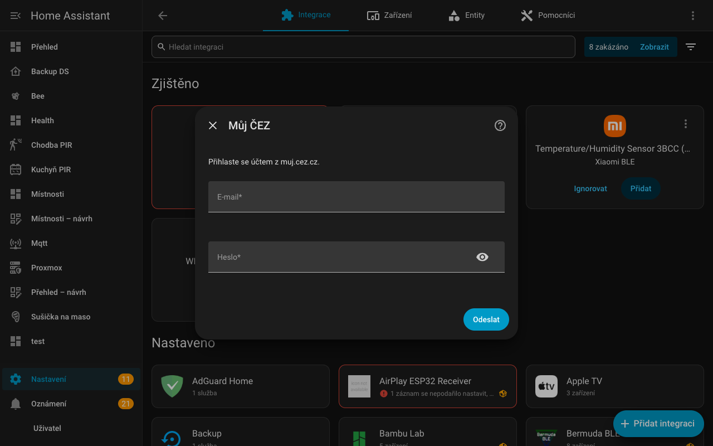
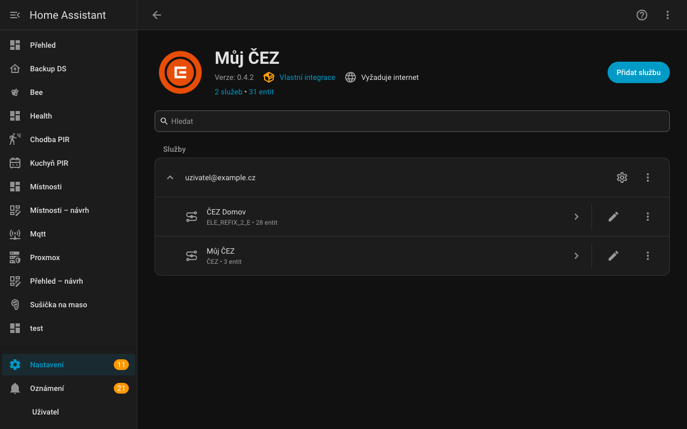
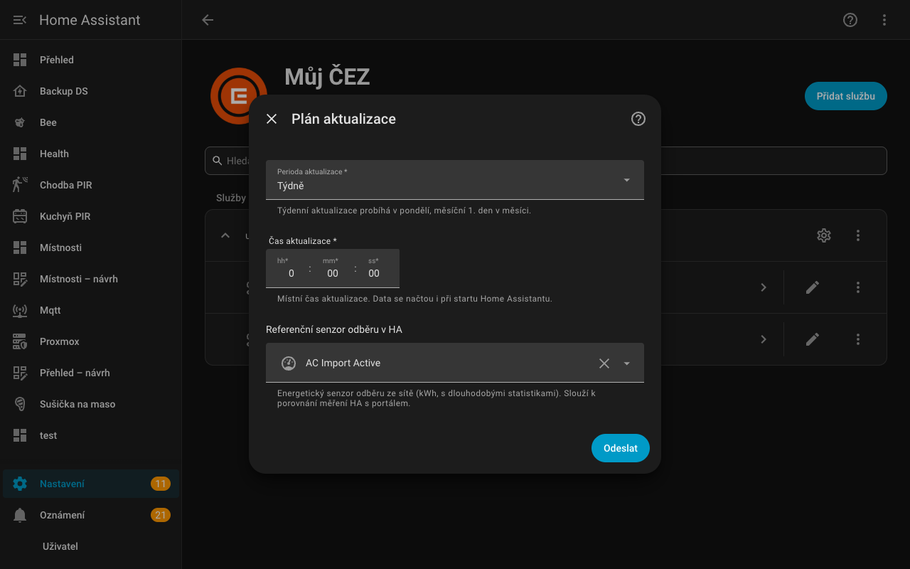
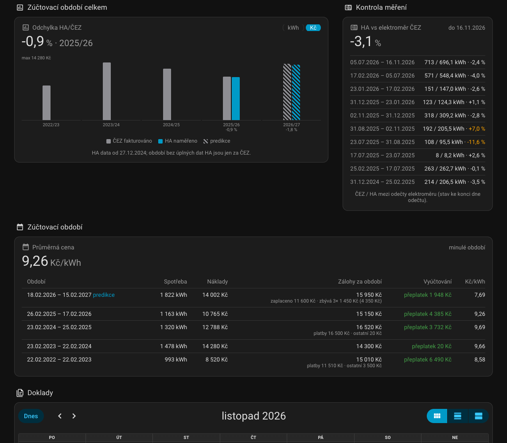

# Můj ČEZ for Home Assistant

Custom integration that loads invoice prediction, advance payments, consumption history
and meter readings from the [muj.cez.cz](https://muj.cez.cz) customer portal (ČEZ Prodej).

The portal has no official API. The integration uses the same JSON API as the web
frontend and signs in with plain HTTP (OAuth2 + PKCE, no browser needed). It can break
when ČEZ changes the portal.

Návod k instalaci a nastavení v češtině: [Instalace a nastavení](#instalace-a-nastavení).

## Entities (per supply point)

| Entity | Unit | Notes |
|---|---|---|
| Predicted invoice balance | CZK | negative = overpayment, positive = to pay |
| Predicted cost for period | CZK | incl. VAT, attribute `cost_without_tax` |
| Recommended advance payment | CZK | |
| Current advance payment | CZK | |
| Predicted consumption for period | kWh | attributes `measured`, `estimated` |
| Billing period end | date | |
| Next advance payment date / amount | date / CZK | |
| Unpaid advance payments | CZK | overdue unpaid amount |
| Last period consumption / cost | kWh / CZK | last closed billing period |
| Meter reading | kWh | latest real reading (VT), `total_increasing` |
| Last invoice | CZK | negative = refund; attributes number, issue/due date |
| Last payment | CZK | attributes date |
| Overdue amount | CZK | unpaid documents after due date, attribute `open_amount` |
| Distribution rate | text | e.g. `D02d - Běžná domácnost…`, attributes `tariff_code`, `recommended` |
| Circuit breaker | A | attribute `phase` (raw portal value) |
| Contract end / Price change date | date | end of fixed-price contract, planned price change |
| Planned outages | count | planned distribution outages, list in attribute `outages` |
| Billing periods | count | closed periods; attribute `periods` with consumption, cost, paid, advances for the whole period (`advances_total`, remaining for the current one), settlement, Kč/kWh per period, last item is the current predicted period |
| EAN, Meter number, Contract number, Customer number, Product | text | diagnostic |
| Grid import / export this month, this year | kWh | smart meter (interval metering) only, see below |
| Smart meter data date | date | last day with smart meter data; attributes `months`, `import_comparison`, `export_comparison`, `payouts`, `statistics` |
| Spot price yesterday | CZK/kWh | average, `min`, `max` (portal history, smart meter accounts) |
| Last update | timestamp | diagnostic |

Account device "Můj ČEZ":

- **Documents** calendar: every accounting document of all contracts on the account
  (invoices, advances, payments, fees, reminders, terminated contracts included), one
  all-day event on the due date (or issue date). Event description shows contract,
  document number, dates, remaining balance and variable symbol.
- **Unread messages** (portal inbox).

Production supply point (PV feed-in, e.g. "POZE Smluvní výkup") gets its own device
"ČEZ <address> výroba" with **Last monthly payout**, **Payouts this year** and **Feed-in
price** (payout / exported kWh); attribute `payouts` holds every month with exported kWh,
price and the value of the export at spot prices. Advance, prediction and meter sensors
are not created for it.

## Smart meter data (interval metering, e.g. PV)

When the portal has interval data for the supply point (`/tapp/...` endpoints), the
integration additionally:

- caches daily grid import and export (history since the meter has data, then only
  new days) and creates the grid import/export sensors,
- imports hourly long-term statistics `muj_cez:grid_import_<place>` and
  `muj_cez:grid_export_<place>`, selectable in the Energy dashboard (delayed by about a day),
- imports hourly spot prices `muj_cez:spot_price` (CZK/kWh): day-ahead results from
  [OTE](https://www.ote-cr.cz) converted with the ČNB EUR rate (identical to the prices the
  ČEZ portal showed until September 2025), the portal is only a fallback; up to yesterday,
- values the exported energy at spot prices per month (payout comparison); hours without
  portal prices use the optional spot price sensor (only as far back as its statistics go).

The first run backfills the history in the background (tens of requests, a few minutes).
Accounts without interval data are detected once a month and nothing else is requested;
no entities or statistics are created for them.

## Dashboard

In the settings (during installation and in the options) choose a dashboard: a new
dashboard "ČEZ" or any existing storage dashboard. The integration generates the ČEZ view
from the entities of this Home Assistant (with or without PV, renamed entities and other
languages work) and adds or replaces only its own view (`cez`). Charts have tooltips, rows
open entity details and the kWh / CZK switch works on touch devices too. Action
`muj_cez.update_dashboard` regenerates it. The view needs these HACS frontend cards:
button-card, stack-in-card and mini-graph-card; a repair issue lists missing ones.

The grid import/export reference sensors are prefilled from the Energy dashboard and the spot
price sensor from cz_energy_spot_prices when installed.

## Comparison with a Home Assistant energy sensor

Set **Reference energy sensor** in the integration options (an energy sensor measuring
grid import with long-term statistics, e.g. `sensor.ac_main_power_import`). Once a day
the integration reads its daily statistics from the recorder and compares them with the
portal:

- **Deviation from ČEZ** sensor: HA vs ČEZ in % for the current period up to the last
  meter reading. Attributes (for charts): `current`, `months` (portal monthly split of
  the current period vs HA, estimated months flagged), `periods` (billing periods ČEZ vs
  HA, current one = HA measured + portal estimate of remaining days), `readings` (meter
  delta between consecutive readings vs HA), `ha_months` (HA per billing-period month for
  year-over-year comparison).
- **Chart unit** select (kWh / CZK) on the account device, used by dashboard cards.

A meter reading dated D is treated as the meter state at the end of day D (same
convention as billing periods). CZK values for HA use the portal price of the same month
or period (cost incl. fixed fees / kWh).

## Actions

`muj_cez.get_documents` returns documents (newest first) with optional filters
`date_from`, `date_to`, `document_type`, `contract`, `unpaid_only`, `limit` (max 1000).

See [docs/dashboard.md](docs/dashboard.md) for a billing periods table card, the calendar
card and an automation example.

The next advance payment date sensor also carries `variable_symbol` and `bank_account`
for payment automations.

Entity names are translated (English, Czech). The integration icon (`brand/icon.png`) is the
ČEZ logo from muj.cez.cz; it is a trademark of ČEZ, a. s., used here only to identify the service.

## Installation

HACS: add this repository as a custom repository (category Integration), install, restart.

Manual: copy `custom_components/muj_cez` to `<config>/custom_components/` and restart.

Then *Settings → Devices & services → Add integration → Můj ČEZ* and enter your
muj.cez.cz e-mail and password.

## Options

- **Update period**: daily, weekly (Mondays) or monthly (1st day of month)
- **Update time**: local time, default `00:00`
- **Reference energy sensor** (optional): HA grid import sensor for the comparison
- **Reference export sensor** (optional): HA grid export sensor, compared with the smart
  meter export per month (attribute `export_comparison`)
- **Spot price sensor** (optional): HA spot price sensor with statistics (CZK/kWh or
  CZK/MWh, e.g. `sensor.current_spot_electricity_price` of cz_energy_spot_prices); fills
  spot prices for the export valuation where the portal has none

Data is also loaded at Home Assistant start. A failed scheduled update is retried
6× every 30 minutes; entities keep their last values meanwhile. Invalid credentials
trigger the re-authentication flow.

## License

MIT, see [LICENSE](LICENSE). The ČEZ logo in `brand/icon.png` is a trademark of ČEZ, a. s.
and is not covered by the license.

## Development

```bash
scripts/setup    # create .venv with Home Assistant test framework
scripts/test     # pytest
scripts/lint     # ruff check + format check
HA_HOST=... HA_SSH_PASS=... scripts/deploy   # copy to HA OS over SSH, check config, restart
CEZ_USER=... CEZ_PASS=... .venv/bin/python tools/smoke.py   # live test against the portal
```

Offline development (no repeated portal queries): capture once, then replay.

```bash
CEZ_USER=... CEZ_PASS=... .venv/bin/python tools/snapshot.py      # .snapshot/cez (git-ignored)
HA_TOKEN=... HA_WS=ws://<ha>:8123/api/websocket \
  .venv/bin/python tools/ha_stats_snapshot.py sensor.ac_main_power_import   # .snapshot/ha
.venv/bin/python tools/smoke.py --offline
```

`tools/offline.py` provides `OfflineCezClient` and `load_ha_daily()` for experiments.

`tools/probe/` contains scripts used to explore the portal API. See
[docs/analyza-proveditelnosti.md](docs/analyza-proveditelnosti.md) for the API analysis (Czech).

Never commit credentials or files from `tools/probe/probe_out/` (personal data, tokens).

## Instalace a nastavení

Integrace je neoficiální: používá stejné rozhraní jako web muj.cez.cz, takže ji může
rozbít změna portálu na straně ČEZ.

**Co je potřeba**

- Home Assistant 2025.8 nebo novější,
- účet na [muj.cez.cz](https://muj.cez.cz) s přihlášením e-mailem a heslem.

### 1. Instalace

**Přes HACS** (doporučeno)

1. HACS → menu ⋮ vpravo nahoře → **Vlastní repozitáře**.
2. Repozitář `https://github.com/KinDR007/ha-muj-cez`, typ **Integrace** → **Přidat**.
3. Vyhledejte **Můj ČEZ** → **Stáhnout**.
4. Restartujte Home Assistant.

**Ručně**

1. Na GitHubu stáhněte repozitář (**Code → Download ZIP**) a rozbalte ho.
2. Složku `custom_components/muj_cez` zkopírujte do konfigurační složky Home Assistantu,
   například přes doplněk Samba share, File editor, Studio Code Server nebo SSH. Výsledek
   musí být `/config/custom_components/muj_cez/manifest.json`.
3. Restartujte Home Assistant: **Nastavení → Systém → ⏻ (vpravo nahoře) → Restartovat
   Home Assistant**.

Aktualizace se dělá stejně: nahraďte složku `muj_cez` novou verzí a restartujte.

### 2. Přidání integrace

1. **Nastavení → Zařízení a služby → Přidat integraci** a vyhledejte „ČEZ“.

   

2. Zadejte e-mail a heslo, kterými se přihlašujete na muj.cez.cz, a klikněte na
   **Odeslat**. Integrace se hned přihlásí a načte data, trvá to několik sekund.

   

   Možné chyby:
   - **Neplatný e-mail nebo heslo**: zkontrolujte, že se stejnými údaji přihlásíte na webu.
   - **Nelze se připojit k muj.cez.cz**: portál je nedostupný nebo HA nemá internet;
     zkuste to později.
   - **Účet nemá žádné odběrné místo**: účet nemá aktivní smlouvu.

3. Po přidání uvidíte u integrace účet (podle e-mailu) se dvěma zařízeními:
   - **ČEZ &lt;adresa odběrného místa&gt;**: senzory vyúčtování, záloh, spotřeby a smlouvy,
   - **Můj ČEZ**: kalendář **Doklady**, počet nepřečtených zpráv a přepínač jednotky grafů
     (kWh / Kč).

   

### 3. Nastavení

Ozubené kolo u účtu otevře **Plán aktualizace**:



- **Perioda aktualizace**: denně, týdně (v pondělí) nebo měsíčně (1. den v měsíci).
  Data na portálu se mění zřídka, týdenní perioda většinou stačí.
- **Čas aktualizace**: místní čas načtení dat, výchozí 00:00.
- **Referenční senzor odběru v HA** (nepovinné): energetický senzor odběru ze sítě v kWh
  s dlouhodobými statistikami, typicky ten, který používá panel Energie. Integrace podle
  něj porovnává měření HA s tím, co eviduje a fakturuje ČEZ (senzor **Odchylka od ČEZ**).
- **Referenční senzor exportu do sítě v HA** (nepovinné): senzor přetoků do sítě, porovná
  se s přetoky naměřenými elektroměrem ČEZ (jen u elektroměru s průběhovým měřením).
- **Senzor spotové ceny v HA** (nepovinné): např. `sensor.current_spot_electricity_price`
  z integrace cz_energy_spot_prices. Portál ČEZ má spotové ceny jen do září 2025; senzor
  doplní ceny pro ocenění přetoků, ovšem jen za dobu, kterou pokrývají jeho statistiky.

- **Dashboard**: kam přidat záložku ČEZ: nový dashboard „ČEZ“ nebo některý existující.
  Záložka se vygeneruje podle entit v tomto HA (s FVE i bez ní) a při každém načtení
  integrace se aktualizuje; ostatní záložky dashboardu zůstanou beze změny. Potřebuje karty
  z HACS (Frontend): **button-card**, **stack-in-card** a **mini-graph-card**. Když chybí,
  integrace to ohlásí v **Nastavení → Opravy**. Ručně jde záložku znovu vytvořit akcí
  `muj_cez.update_dashboard`.

Senzory odběru a exportu se při instalaci předvyplní podle panelu Energie a senzor spotové
ceny podle integrace cz_energy_spot_prices; vše lze změnit.

Uložením se integrace znovu načte. Data se načítají také při každém startu Home Assistantu.
Když aktualizace selže, zkouší se znovu 6× po 30 minutách a entity mezitím drží poslední
hodnoty. Po změně hesla na portálu zobrazí Home Assistant v **Nastavení** výzvu
k novému přihlášení; stačí zadat nové heslo.

### 4. Entity


Hlavní senzory odběrného místa:

| Senzor | Význam |
|---|---|
| Predikce vyúčtování | očekávaný výsledek vyúčtování, záporné číslo = přeplatek |
| Predikované náklady / spotřeba za období | odhad ČEZ za celé zúčtovací období |
| Aktuální / doporučená záloha | výše zálohy a doporučení ČEZ |
| Splatnost a výše příští zálohy | atributy obsahují variabilní symbol a číslo účtu |
| Nezaplacené zálohy, Částka po splatnosti | dlužné částky |
| Poslední faktura / platba | poslední doklady |
| Stav elektroměru | poslední odečet |
| Spotřeba a náklady za minulé období | uzavřené zúčtovací období |
| Distribuční sazba, Hlavní jistič, Konec smlouvy, Datum změny ceny | údaje ze smlouvy |
| Plánované odstávky | odstávky distribuce, seznam v atributu `outages` |
| Zúčtovací období | historie období v atributu `periods`: spotřeba, náklady, zálohy za období, vyúčtování, Kč/kWh |
| Odchylka od ČEZ | porovnání s referenčním senzorem v %, data pro grafy v atributech |

Diagnostické entity: EAN, číslo elektroměru, číslo smlouvy, zákaznické číslo, produkt,
čas poslední aktualizace.

**Fotovoltaika a průběhové měření:** pokud portál pro odběrné místo eviduje průběhová data
elektroměru, přibudou senzory **Odběr ze sítě** a **Přetoky do sítě** (tento měsíc, letos),
**Data elektroměru k** a **Spotová cena včera**. Integrace také importuje hodinové
statistiky odběru a přetoků, které jdou vybrat v panelu Energie, a spotové ceny.
Výrobní místo (výkup přetoků) má vlastní zařízení se senzory **Výkup za poslední měsíc**,
**Výkup letos** a **Výkupní cena**. Bez průběhových dat se nic z toho nevytvoří.

Kalendář **Doklady** obsahuje všechny doklady všech smluv na účtu (faktury, zálohy,
platby, poplatky). Doklady lze vypsat i akcí `muj_cez.get_documents` s filtry
(**Vývojářské nástroje → Akce**).

### 5. Dashboard

Ukázka pohledu ČEZ s predikcí, měsíčními a meziročními grafy (přepínání kWh / Kč)
a porovnáním s měřením HA:




Tento pohled používá vlastní karty z HACS (button-card, stack-in-card, mini-graph-card,
card-mod) a generuje ho skript `tools/dashboard/build_cez_view.py` pro Dashboard Editor.
Jednodušší karty bez dalších závislostí (tabulka zúčtovacích období, kalendář dokladů,
automatizace upozornění na nezaplacené doklady) jsou v [docs/dashboard.md](docs/dashboard.md).

### Soukromí

Přihlašovací údaje ukládá Home Assistant lokálně v konfiguraci integrace. Integrace
komunikuje s portálem ČEZ a data načítá jednou za zvolenou periodu (a při startu).
Jen u účtů s průběhovým měřením stahuje navíc veřejné spotové ceny z OTE a kurz EUR
z ČNB; posílá se jen datum, žádné osobní údaje.

