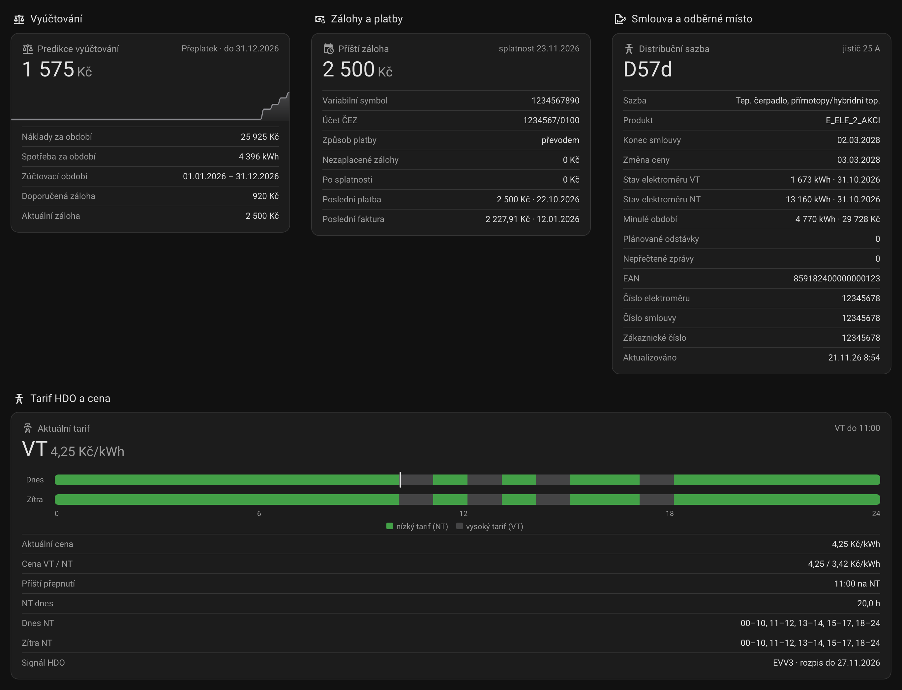
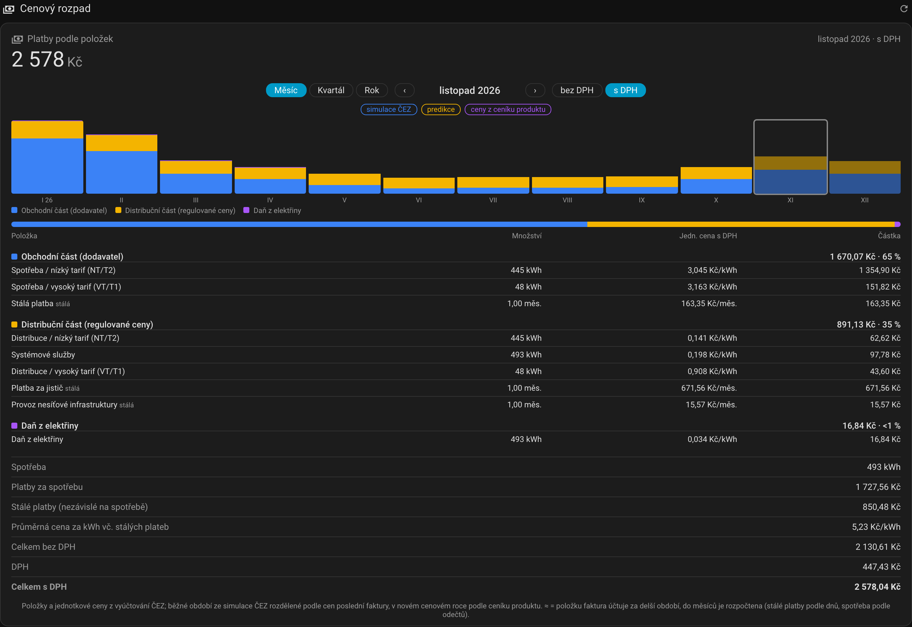
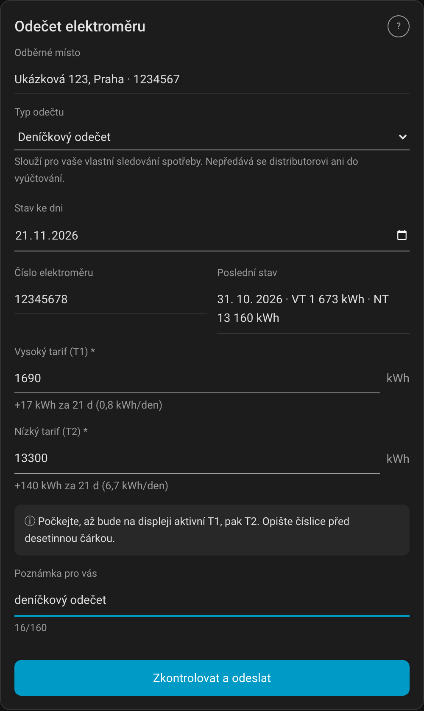
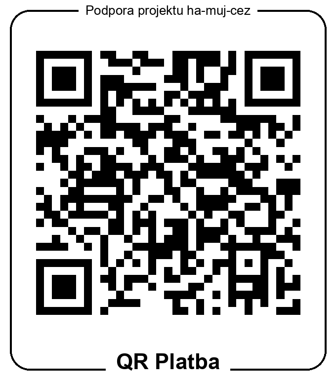

# Můj ČEZ pro Home Assistant

[](https://github.com/KinDR007/ha-muj-cez/releases)
[](https://hacs.xyz)
[](https://paypal.me/KinDR007)

**EN:** Home Assistant integration for the Můj ČEZ customer portal ([muj.cez.cz](https://muj.cez.cz)):
invoice prediction, advance payments, price breakdown, meter readings, consumption, documents
and HDO, with a ready-made dashboard. The documentation is in Czech.

**CZ:** Integrace Home Assistantu pro zákaznický portál Můj ČEZ ([muj.cez.cz](https://muj.cez.cz)):
predikce vyúčtování, zálohy, cenový rozpad, odečet elektroměru, spotřeba, doklady a HDO,
včetně hotového dashboardu.



## Funkce

- **Vyúčtování a zálohy**: predikce přeplatku nebo nedoplatku, náklady a spotřeba za období,
  doporučená záloha, příští záloha s variabilním symbolem, neuhrazené doklady.
- **Smlouva a elektroměr**: sazba, jistič, produkt, konec smlouvy, poslední stav VT / NT,
  plánované odstávky.
- **Cenový rozpad**: kolik stojí každá položka vyúčtování za měsíc, kvartál a rok, s DPH
  i bez, z faktur a ceníků.
- **Odečet elektroměru**: zadání samoodečtu přímo z Home Assistantu s kontrolou hodnot
  jako na portálu.
- **HDO a aktuální cena**: nízký / vysoký tarif z portálu ČEZ Distribuce, příští přepnutí,
  cena za kWh.
- **Průběhové měření a FVE**: odběr a přetoky po dnech i čtvrthodinách, statistiky pro panel
  Energie, výkup přetoků, spotové ceny.
- **Porovnání s měřením v HA**: odchylka vlastního elektroměru od údajů ČEZ.
- **Doklady**: kalendář všech dokladů a akce pro automatizace.
- **Hotový dashboard**: pro každé odběrné místo záložka s vnitřními záložkami Přehled, Ceny
  a Odečet, vygeneruje se sama podle entit.

## Ukázky

<table>
  <tr>
    <td colspan="2"><b>Cenový rozpad</b> po měsících, kvartálech a letech<br></td>
  </tr>
  <tr>
    <td width="40%"><b>Odečet elektroměru</b><br></td>
    <td width="60%"><b>Spotová cena dnes a zítra</b><br><br><br><b>Odběr a přetoky po měsících</b><br><br><br><b>Výkup po měsících</b><br></td>
  </tr>
</table>

Osobní údaje na snímcích (adresa, EAN, čísla smluv a elektroměru) jsou smyšlené.

## Instalace

**HACS** (doporučeno)

Integrace je ve výchozím katalogu HACS.

1. [](https://my.home-assistant.io/redirect/hacs_repository/?owner=KinDR007&repository=ha-muj-cez&category=integration)
   nebo v HACS (případně v Marketu) vyhledejte **Můj ČEZ**.
2. **Stáhnout** a restartujte Home Assistant.
3. Pro dashboard stáhněte v HACS také karty **button-card**, **stack-in-card**
   a **mini-graph-card** ([podrobnosti](https://github.com/KinDR007/ha-muj-cez/blob/main/docs/guide/instalace.md#karty-pro-dashboard)).

**Ručně:** složku `custom_components/muj_cez` zkopírujte do `/config/custom_components/`
a restartujte Home Assistant.

Pak **Nastavení → Zařízení a služby → Přidat integraci → Můj ČEZ** a přihlaste se e-mailem
a heslem z muj.cez.cz. Podrobně v kapitole [Instalace a přihlášení](https://github.com/KinDR007/ha-muj-cez/blob/main/docs/guide/instalace.md).

Požadavky: Home Assistant 2025.8 nebo novější. Integrace je neoficiální a používá stejné
rozhraní jako web Můj ČEZ, takže ji může rozbít změna portálu.

## Nastavení

Při přidání i později přes ozubené kolo u účtu:

- perioda a čas aktualizace (denně, týdně, měsíčně),
- referenční senzory odběru a přetoků v HA pro porovnání, senzor spotové ceny,
- dashboard (nový „ČEZ“ nebo existující),
- HDO z ČEZ Distribuce, cenový rozpad.

Popis všech voleb: [Nastavení](https://github.com/KinDR007/ha-muj-cez/blob/main/docs/guide/nastaveni.md).

## Dokumentace

[Uživatelská příručka](https://github.com/KinDR007/ha-muj-cez/blob/main/docs/guide/README.md) se snímky obrazovky:

- [Instalace a přihlášení](https://github.com/KinDR007/ha-muj-cez/blob/main/docs/guide/instalace.md)
- [Nastavení](https://github.com/KinDR007/ha-muj-cez/blob/main/docs/guide/nastaveni.md)
- [Entity](https://github.com/KinDR007/ha-muj-cez/blob/main/docs/guide/entity.md)
- [Dashboard ČEZ](https://github.com/KinDR007/ha-muj-cez/blob/main/docs/guide/dashboard-cez.md)
- [Cenový rozpad](https://github.com/KinDR007/ha-muj-cez/blob/main/docs/guide/cenovy-rozpad.md)
- [Odečet elektroměru](https://github.com/KinDR007/ha-muj-cez/blob/main/docs/guide/odecet.md)
- [Akce a automatizace](https://github.com/KinDR007/ha-muj-cez/blob/main/docs/guide/akce.md)
- [Řešení potíží](https://github.com/KinDR007/ha-muj-cez/blob/main/docs/guide/potize.md)
- [Pro pokročilé](https://github.com/KinDR007/ha-muj-cez/blob/main/docs/guide/pokrocile.md): atributy, statistiky, websocket příkazy

Chybu nebo nápad nahlaste v [Issues](https://github.com/KinDR007/ha-muj-cez/issues/new/choose).

## Soukromí

Přihlašovací údaje ukládá Home Assistant lokálně. Integrace komunikuje jen s portálem ČEZ
(a se zapnutým HDO s portálem ČEZ Distribuce); u účtů s průběhovým měřením navíc stahuje
veřejné spotové ceny z OTE a kurz z ČNB, bez osobních údajů.

## Podpořte vývoj

Integrace je zdarma a vyvíjím ji ve volném čase. Portál ČEZ se průběžně mění a každá jeho
změna může integraci rozbít. Udržet ji funkční, opravovat chyby po změnách portálu, testovat
nové verze Home Assistantu a přidávat funkce jako cenový rozpad nebo odečet elektroměru stojí
desítky hodin práce.

Pokud vám integrace šetří čas nebo peníze, budu rád za příspěvek na další vývoj, ať už
jednorázově, nebo třeba jednou za rok. Částku zadáte v bankovní aplikaci podle sebe.



QR platba (CZK) nebo [PayPal](https://paypal.me/KinDR007)

Pomůže i hvězdička na GitHubu, nahlášení chyby nebo nápad v
[Issues](https://github.com/KinDR007/ha-muj-cez/issues). Děkuji!

## Licence

MIT, viz [LICENSE](https://github.com/KinDR007/ha-muj-cez/blob/main/LICENSE). Logo ČEZ
v `brand/icon.png` pochází z muj.cez.cz, je ochrannou známkou ČEZ, a. s., slouží jen
k označení služby a licence se na něj nevztahuje.

## Vývoj

```bash
scripts/setup    # .venv s testovacím prostředím Home Assistantu
scripts/test     # pytest
scripts/lint     # ruff check + kontrola formátu
HA_HOST=... HA_SSH_PASS=... scripts/deploy   # kopie na HA OS přes SSH, kontrola konfigurace, restart
CEZ_USER=... CEZ_PASS=... .venv/bin/python tools/smoke.py   # živý test proti portálu
```

Vývoj offline bez opakovaných dotazů na portál: data se jednou zachytí a pak přehrávají.

```bash
CEZ_USER=... CEZ_PASS=... .venv/bin/python tools/snapshot.py      # .snapshot/cez (mimo git)
HA_TOKEN=... HA_WS=ws://<ha>:8123/api/websocket \
  .venv/bin/python tools/ha_stats_snapshot.py sensor.ac_main_power_import   # .snapshot/ha
.venv/bin/python tools/smoke.py --offline
```

- `tools/offline.py`: `OfflineCezClient` a `load_ha_daily()` pro experimenty.
- `tools/probe/`: skripty pro průzkum API portálu, popis API v [docs/api](https://github.com/KinDR007/ha-muj-cez/blob/main/docs/api/README.md).
- `tools/docs/shots.mjs`: anonymizované snímky obrazovky pro příručku.

Nikdy necommitujte přihlašovací údaje ani soubory z `tools/probe/probe_out/` (osobní údaje,
tokeny).
