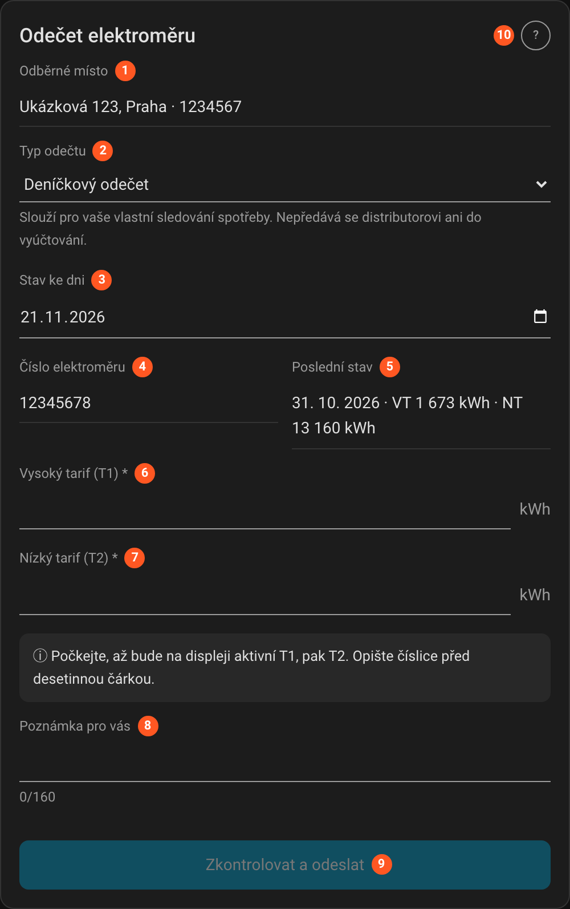
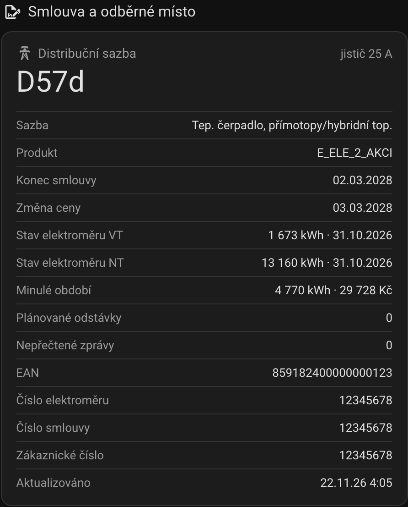
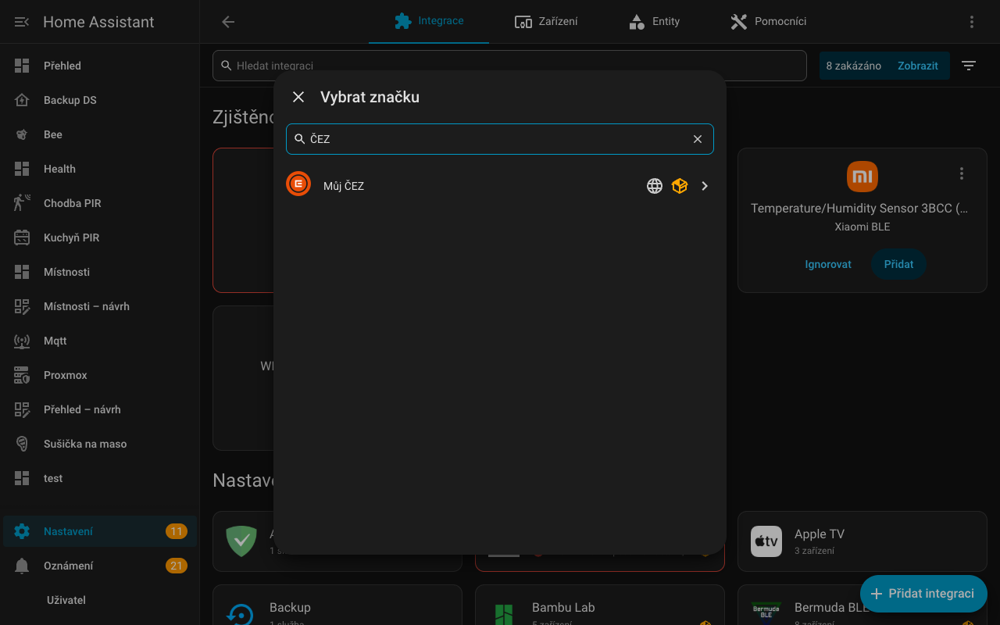
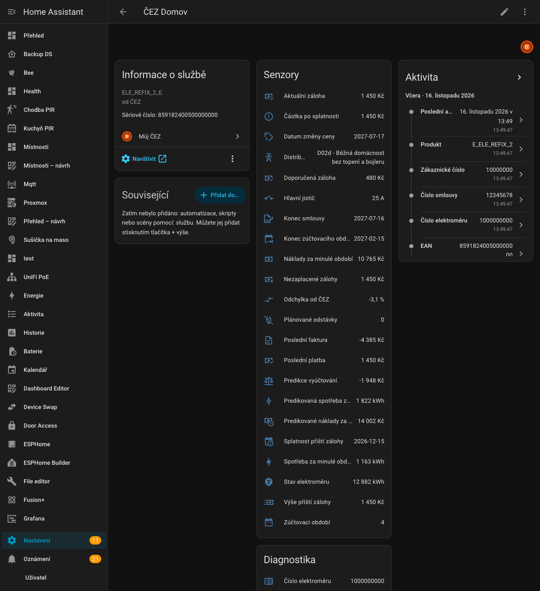
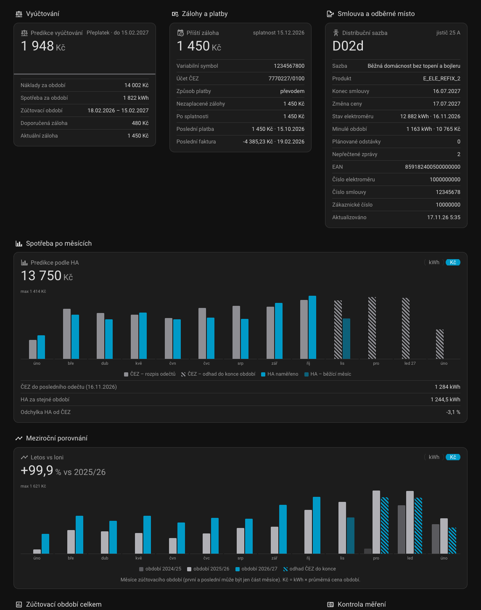
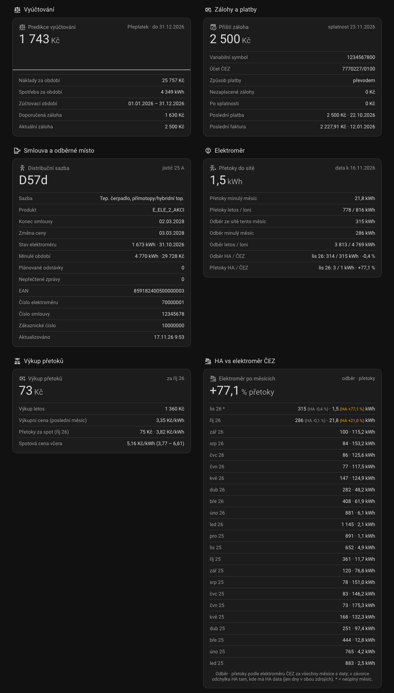
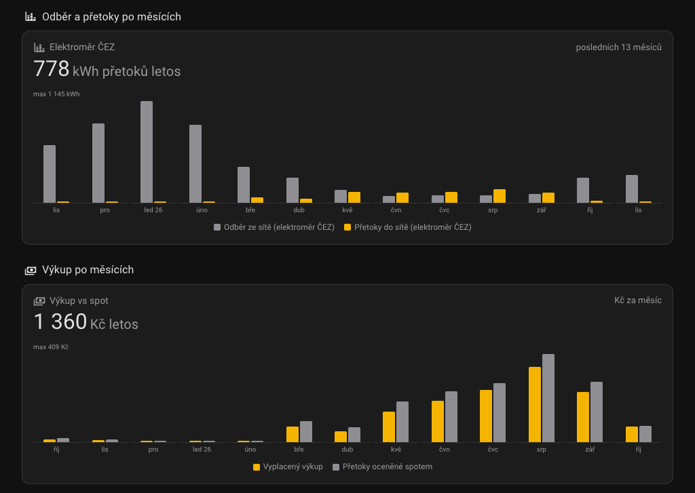
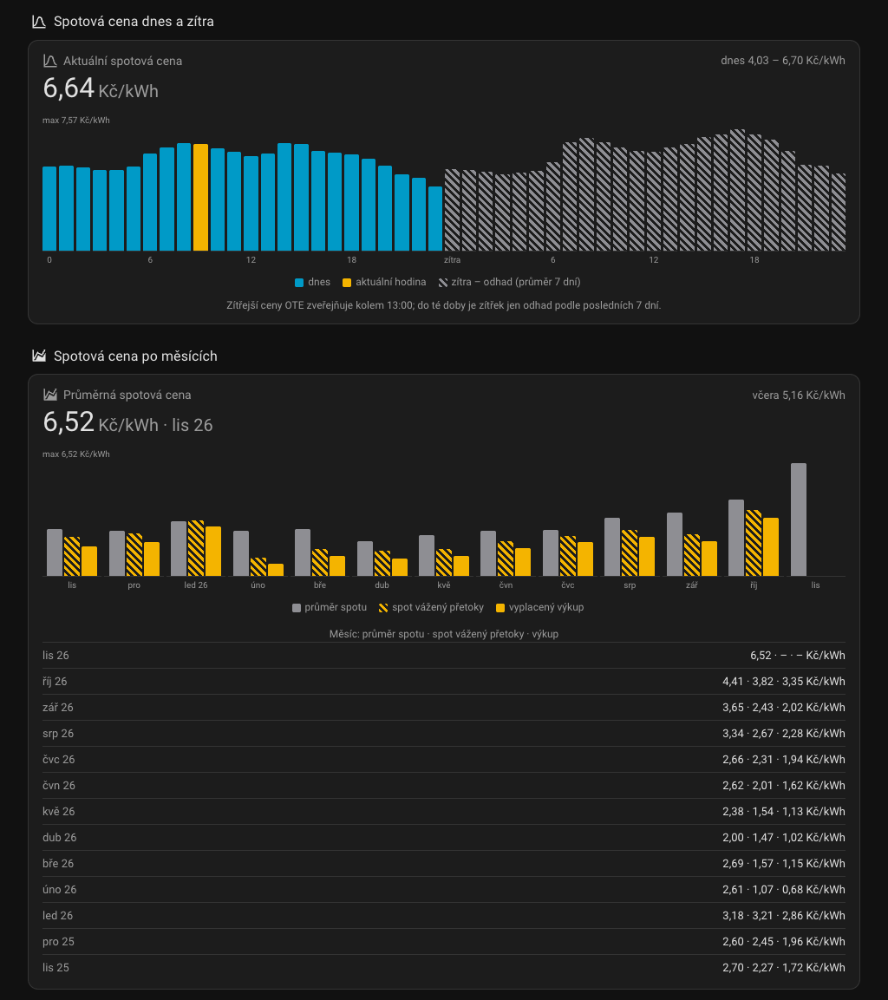
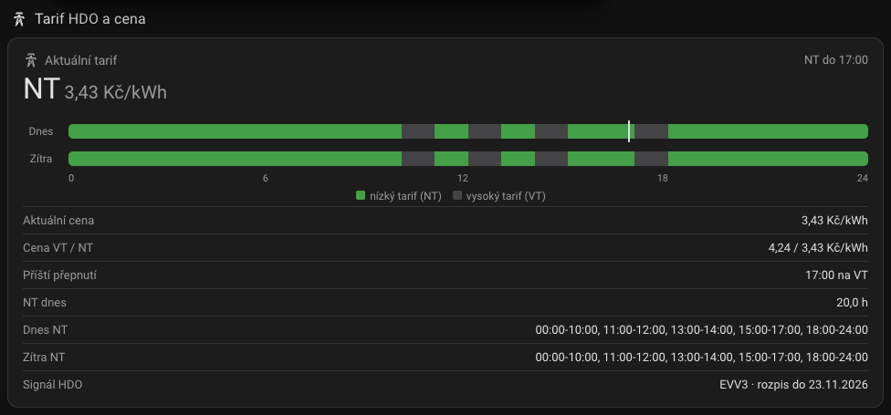
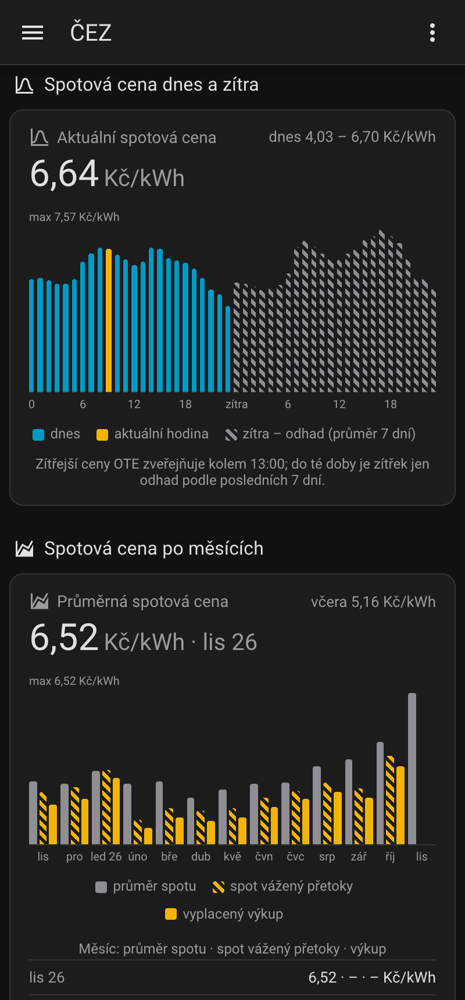

# Můj ČEZ for Home Assistant

[](https://paypal.me/KinDR007)

Custom integration that loads invoice prediction, advance payments, consumption history
and meter readings from the [muj.cez.cz](https://muj.cez.cz) customer portal (ČEZ Prodej).

The portal has no official API. The integration uses the same JSON API as the web
frontend and signs in with plain HTTP (OAuth2 + PKCE, no browser needed). It can break
when ČEZ changes the portal.

**User guide / Uživatelská příručka** (česky, se snímky obrazovky): [docs/guide](https://github.com/KinDR007/ha-muj-cez/blob/main/docs/guide/README.md): instalace,
nastavení, entity, dashboard, cenový rozpad, odečet elektroměru, akce, řešení potíží.

<a href="https://github.com/KinDR007/ha-muj-cez/blob/main/docs/guide/README.md"></a>
<a href="https://github.com/KinDR007/ha-muj-cez/blob/main/docs/guide/README.md"></a>

Stručný návod v češtině: [Instalace a nastavení](#instalace-a-nastavení).

## Entities (per supply point)

| Entity | Unit | Notes |
|---|---|---|
| Predicted invoice balance | CZK | negative = overpayment, positive = to pay |
| Predicted cost for period | CZK | incl. VAT, attribute `cost_without_tax` |
| Recommended advance payment | CZK | |
| Current advance payment | CZK | |
| Predicted consumption for period | kWh | attributes `measured`, `estimated` |
| Billing period end | date | |
| Next advance payment date / amount | date / CZK | |
| Unpaid advance payments | CZK | overdue unpaid amount |
| Last period consumption / cost | kWh / CZK | last closed billing period |
| Meter reading | kWh | latest real reading (VT), `total_increasing`, attribute `low_tariff` |
| Meter reading (low tariff) | kWh | dual tariff only: NT register of the latest reading |
| Last invoice | CZK | negative = refund; attributes number, issue/due date |
| Last payment | CZK | attributes date |
| Overdue amount | CZK | unpaid documents after due date, attribute `open_amount` |
| Distribution rate | text | e.g. `D02d - Běžná domácnost…`, attributes `tariff_code`, `recommended` |
| Circuit breaker | A | attribute `phase` (raw portal value) |
| Contract end / Price change date | date | end of fixed-price contract, planned price change |
| Planned outages | count | planned distribution outages, list in attribute `outages` |
| Billing periods | count | closed periods; attribute `periods` with consumption, cost, paid, advances for the whole period (`advances_total`, remaining for the current one), settlement, Kč/kWh per period, last item is the current predicted period |
| EAN, Meter number, Contract number, Customer number, Product | text | diagnostic |
| Grid import / export this month, this year | kWh | smart meter (interval metering) only, see below |
| Smart meter data date | date | last day with smart meter data; attributes `months`, `import_comparison`, `export_comparison`, `payouts`, `statistics` |
| Spot price yesterday | CZK/kWh | average, `min`, `max` (portal history, smart meter accounts) |
| Last update | timestamp | diagnostic |

Account device "Můj ČEZ":

- **Documents** calendar: every accounting document of all contracts on the account
  (invoices, advances, payments, fees, reminders, terminated contracts included), one
  all-day event on the due date (or issue date). Event description shows contract,
  document number, dates, remaining balance and variable symbol.
- **Unread messages** (portal inbox).

Production supply point (PV feed-in, e.g. "POZE Smluvní výkup") gets its own device
"ČEZ <address> výroba" with **Last monthly payout**, **Payouts this year** and **Feed-in
price** (payout / exported kWh); attribute `payouts` holds every month with exported kWh,
price and the value of the export at spot prices. Advance, prediction and meter sensors
are not created for it.

## Smart meter data (interval metering, e.g. PV)

When the portal has interval data for the supply point (`/tapp/...` endpoints), the
integration additionally:

- caches daily grid import and export (history since the meter has data, then only
  new days) and creates the grid import/export sensors,
- imports hourly long-term statistics `muj_cez:grid_import_<place>` and
  `muj_cez:grid_export_<place>`, selectable in the Energy dashboard (delayed by about a day),
- imports hourly spot prices `muj_cez:spot_price` (CZK/kWh): day-ahead results from
  [OTE](https://www.ote-cr.cz) converted with the ČNB EUR rate (identical to the prices the
  ČEZ portal showed until September 2025), the portal is only a fallback; up to yesterday,
- values the exported energy at spot prices per month (payout comparison); hours without
  portal prices use the optional spot price sensor (only as far back as its statistics go),
- keeps the 15 min import/export values of the current month and the 12 months before it
  (HA statistics are hourly only) in its own storage (`.storage/muj_cez.<entry>.profile_*`,
  under 1 MB; older days are deleted) for the dashboard section
  "Průběh po 15 minutách"; websocket command `muj_cez/profile` (`entity_id` of the
  smart meter date sensor, optional `month` `YYYY-MM`) returns one month.

The first run backfills the history in the background (tens of requests, a few minutes).
Accounts without interval data are detected once a month and nothing else is requested;
no entities or statistics are created for them.

## HDO and current price (ČEZ Distribuce)

The low/high tariff switching times (HDO) are not in muj.cez.cz, they come from the
[ČEZ Distribuce](https://dip.cezdistribuce.cz) portal. It accepts the same ČEZ ID
credentials, so no extra setup is needed (option **HDO from ČEZ Distribuce**, on by
default). The login flow and endpoints follow
[MattXcz/CEZ](https://github.com/MattXcz/CEZ) (MIT).

- **Tariff (HDO)**: `low` / `high` now; attributes `today`, `tomorrow` (NT intervals),
  `low_hours_today`, `signal`, `schedule_until`
- **Next tariff switch**: timestamp
- **Current price** (CZK/kWh with VAT): the per-kWh price of the current tariff from the
  latest invoice simulation items (energy + distribution, fixed fees excluded);
  attributes `price_vt`, `price_nt`. Single tariff points get it without HDO.

The schedule (about 7 days ahead) is loaded at start, with regular updates and daily at
00:20, and stored, so the tariff switches on time without the portal and survives
outages of a few days. Supply points without HDO (single tariff, other distributors)
get no HDO entities; a failing portal only logs a warning.

## Several customer accounts (shared access)

When the ČEZ ID gives access to several customer accounts (e.g. another person shared
their account with you), the setup asks which account to load. The integration then
sends the chosen account with every request (header `X-COL-PARTNER`, as the portal web
does). Add another account as another instance of the integration with the same login.
Entries created before 1.2.0 load the portal's default account.

## Diagnostics for issue reports

**Settings → Devices & services → Můj ČEZ → ⋮ → Download diagnostics** contains, besides
the redacted parsed data, pseudonymized raw portal responses of every customer account
of the login (account list, supply points, latest meter readings). Names, addresses,
contacts and every identifier are replaced by placeholders that stay the same across
the responses; dates, kWh and codebook values are kept. Please check the file before
attaching it to an issue.

## Dashboard

In the settings (during installation and in the options) choose a dashboard: a new
dashboard "ČEZ" or any existing storage dashboard. The integration generates the ČEZ view
from the entities of this Home Assistant (with or without PV, renamed entities and other
languages work) and adds or replaces only its own view (`cez`). Charts have tooltips, rows
open entity details and the kWh / CZK switch works on touch devices too. Action
`muj_cez.update_dashboard` regenerates it. The view needs the cards button-card,
stack-in-card and mini-graph-card. With **Install missing cards** (default on) the
integration installs missing ones through the HA Marketplace or HACS (their own download
command, so they keep updating the cards), otherwise it downloads the latest GitHub release
into `/config/www/muj_cez/cards/` and registers the Lovelace resource. When the option is off
or installing fails, a repair issue offers a **Fix** button that installs them.

The grid import/export reference sensors are prefilled from the Energy dashboard and the spot
price sensor from cz_energy_spot_prices when installed.

**Price breakdown** (option **Price breakdown**; own tab `cez-ceny` of the ČEZ dashboard, icon next to the ČEZ view): what each item costs per
month, quarter or year, with or without VAT: supplier part (energy, fixed fee), distribution
part (regulated prices: distribution, circuit breaker, system services, POZE, infrastructure),
electricity tax and the PV payout. History comes from the settlements (the CSV data file of the
invoice, or its PDF when the portal has no CSV; each invoice is downloaded once, the first run
fetches 4 years), the current billing period from the ČEZ simulation split with the unit
prices of the last invoice; in a new price year (before an invoice with the new prices) with the
product price list from the portal (PDF "Ceník", column of the supply point's distribution tariff
and circuit breaker), also combined with the last invoice (old product with new distribution
prices). A month is split only when these prices explain the simulated amounts, otherwise it shows
the simulation totals. Items an invoice charges for a longer period are split into months (fixed
fees by days, consumption by meter readings) and marked with ≈. Corrective or overlapping
settlements: the later document applies to the days it covers. The view
loads the data through the websocket command `muj_cez/prices`. PDF invoices need `pypdf`
(installed by Home Assistant from the integration requirements).

**Meter reading** (tab `cez-odecet`, icon `mdi:counter`): the integration's own card
`custom:muj-cez-reading-card` (served by the integration, no HACS needed; optional card
options `entry_id`, `ean`, `title`) for entering a customer meter reading (samoodečet) like on
the portal: supply point (all electricity points of the account), reading type (control
reading for the distributor, diary, extraordinary billing, billing information), date, VT and
NT (dual tariff only) in whole kWh and a note (max. 160 characters). The values are checked
as you type, with the portal's rules: lower than the previous reading is an error, unusually
high (more than 1.5× the usual consumption since the previous reading) a warning, one reading
of a limited type per day, control readings only while the yearly limit allows. Before sending
a summary with the consumption since the previous reading is shown, then the reading is sent to
the portal (only Home Assistant administrators can send). Websocket commands `muj_cez/reading_form`,
`muj_cez/reading_check`, `muj_cez/reading_submit`; portal API in
[docs/api/self-meter-reading.md](https://github.com/KinDR007/ha-muj-cez/blob/main/docs/api/self-meter-reading.md).

## Comparison with a Home Assistant energy sensor

Set **Reference energy sensor** in the integration options (an energy sensor measuring
grid import with long-term statistics, e.g. `sensor.ac_main_power_import`). Once a day
the integration reads its daily statistics from the recorder and compares them with the
portal:

- **Deviation from ČEZ** sensor: HA vs ČEZ in % for the current period up to the last
  meter reading. Attributes (for charts): `current`, `months` (portal monthly split of
  the current period vs HA, estimated months flagged), `periods` (billing periods ČEZ vs
  HA, current one = HA measured + portal estimate of remaining days), `readings` (meter
  delta between consecutive readings vs HA), `ha_months` (HA per billing-period month for
  year-over-year comparison).
- **Chart unit** select (kWh / CZK) on the account device, used by dashboard cards.

A meter reading dated D is treated as the meter state at the end of day D (same
convention as billing periods). CZK values for HA use the portal price of the same month
or period (cost incl. fixed fees / kWh).

## Actions

`muj_cez.get_documents` returns documents (newest first) with optional filters
`date_from`, `date_to`, `document_type`, `contract`, `unpaid_only`, `limit` (max 1000).

See [docs/dashboard.md](https://github.com/KinDR007/ha-muj-cez/blob/main/docs/dashboard.md) for a billing periods table card, the calendar
card and an automation example.

The next advance payment date sensor also carries `variable_symbol` and `bank_account`
for payment automations.

Entity names are translated (English, Czech). The integration icon (`brand/icon.png`) is the
ČEZ logo from muj.cez.cz; it is a trademark of ČEZ, a. s., used here only to identify the service.

## Installation

HACS: add this repository as a custom repository (category Integration), install, restart.

Manual: copy `custom_components/muj_cez` to `<config>/custom_components/` and restart.

Then *Settings → Devices & services → Add integration → Můj ČEZ* and enter your
muj.cez.cz e-mail and password.

## Options

- **Update period**: daily, weekly (Mondays) or monthly (1st day of month)
- **Update time**: local time, default `00:00`
- **Reference energy sensor** (optional): HA grid import sensor for the comparison
- **Reference export sensor** (optional): HA grid export sensor, compared with the smart
  meter export per month (attribute `export_comparison`)
- **Spot price sensor** (optional): HA spot price sensor with statistics (CZK/kWh or
  CZK/MWh, e.g. `sensor.current_spot_electricity_price` of cz_energy_spot_prices); fills
  spot prices for the export valuation where the portal has none
- **HDO from ČEZ Distribuce** (default on): tariff switching times, see above
- **Price breakdown** (default off; on for installations from before the option): downloads
  the settlements and product price lists and adds the "Cenový rozpad" tab, see Dashboard. Off:
  none of this is downloaded, the tab is not created and turning it off deletes the downloaded
  invoices. `pypdf` (PDF invoices) is installed only when the option is on.

Data is also loaded at Home Assistant start. A failed scheduled update is retried
6× every 30 minutes; entities keep their last values meanwhile. Invalid credentials
trigger the re-authentication flow.

## Support the project


The integration is free and developed in my spare time. The ČEZ portal changes over time and
every change can break it; keeping it working, fixing it after portal changes, testing new
Home Assistant versions and adding features takes many hours. If it saves you time or money,
a contribution to further development is appreciated: [PayPal](https://paypal.me/KinDR007) or
the Czech QR payment above (CZK, any amount). A GitHub star, a bug report or an idea in
[Issues](https://github.com/KinDR007/ha-muj-cez/issues) helps too. Thank you!

## License

MIT, see [LICENSE](LICENSE). The ČEZ logo in `brand/icon.png` is a trademark of ČEZ, a. s.
and is not covered by the license.

## Development

```bash
scripts/setup    # create .venv with Home Assistant test framework
scripts/test     # pytest
scripts/lint     # ruff check + format check
HA_HOST=... HA_SSH_PASS=... scripts/deploy   # copy to HA OS over SSH, check config, restart
CEZ_USER=... CEZ_PASS=... .venv/bin/python tools/smoke.py   # live test against the portal
```

Offline development (no repeated portal queries): capture once, then replay.

```bash
CEZ_USER=... CEZ_PASS=... .venv/bin/python tools/snapshot.py      # .snapshot/cez (git-ignored)
HA_TOKEN=... HA_WS=ws://<ha>:8123/api/websocket \
  .venv/bin/python tools/ha_stats_snapshot.py sensor.ac_main_power_import   # .snapshot/ha
.venv/bin/python tools/smoke.py --offline
```

`tools/offline.py` provides `OfflineCezClient` and `load_ha_daily()` for experiments.

`tools/probe/` contains scripts used to explore the portal API. See
[docs/analyza-proveditelnosti.md](https://github.com/KinDR007/ha-muj-cez/blob/main/docs/analyza-proveditelnosti.md) for the API analysis (Czech).

Never commit credentials or files from `tools/probe/probe_out/` (personal data, tokens).

## Instalace a nastavení

Integrace je neoficiální: používá stejné rozhraní jako web muj.cez.cz, takže ji může
rozbít změna portálu na straně ČEZ.

**Co je potřeba**

- Home Assistant 2025.8 nebo novější,
- účet na [muj.cez.cz](https://muj.cez.cz) s přihlášením e-mailem a heslem.

### 1. Instalace

**Přes HACS** (doporučeno)

1. HACS → menu ⋮ vpravo nahoře → **Vlastní repozitáře**.
2. Repozitář `https://github.com/KinDR007/ha-muj-cez`, typ **Integrace** → **Přidat**.
3. Vyhledejte **Můj ČEZ** → **Stáhnout**.
4. Restartujte Home Assistant.

**Ručně**

1. Na GitHubu stáhněte repozitář (**Code → Download ZIP**) a rozbalte ho.
2. Složku `custom_components/muj_cez` zkopírujte do konfigurační složky Home Assistantu,
   například přes doplněk Samba share, File editor, Studio Code Server nebo SSH. Výsledek
   musí být `/config/custom_components/muj_cez/manifest.json`.
3. Restartujte Home Assistant: **Nastavení → Systém → ⏻ (vpravo nahoře) → Restartovat
   Home Assistant**.

Aktualizace se dělá stejně: nahraďte složku `muj_cez` novou verzí a restartujte.

### 2. Přidání integrace

1. **Nastavení → Zařízení a služby → Přidat integraci** a vyhledejte „ČEZ“.

   

2. Zadejte e-mail a heslo, kterými se přihlašujete na muj.cez.cz, a klikněte na
   **Odeslat**. Integrace se hned přihlásí a načte data, trvá to několik sekund.

   

   Možné chyby:
   - **Neplatný e-mail nebo heslo**: zkontrolujte, že se stejnými údaji přihlásíte na webu.
   - **Nelze se připojit k muj.cez.cz**: portál je nedostupný nebo HA nemá internet;
     zkuste to později.
   - **Účet nemá žádné odběrné místo**: účet nemá aktivní smlouvu.

3. Po přidání uvidíte u integrace účet (podle e-mailu) se dvěma zařízeními:
   - **ČEZ &lt;adresa odběrného místa&gt;**: senzory vyúčtování, záloh, spotřeby a smlouvy,
   - **Můj ČEZ**: kalendář **Doklady**, počet nepřečtených zpráv a přepínač jednotky grafů
     (kWh / Kč).

   

### 3. Nastavení

Při instalaci (krok **Nastavení** po přihlášení) i později přes ozubené kolo u účtu:


- **Perioda aktualizace**: denně, týdně (v pondělí) nebo měsíčně (1. den v měsíci).
  Data na portálu se mění zřídka, týdenní perioda většinou stačí.
- **Čas aktualizace**: místní čas načtení dat, výchozí 00:00.
- **Referenční senzor odběru v HA** (nepovinné): energetický senzor odběru ze sítě v kWh
  s dlouhodobými statistikami, typicky ten, který používá panel Energie. Integrace podle
  něj porovnává měření HA s tím, co eviduje a fakturuje ČEZ (senzor **Odchylka od ČEZ**).
- **Referenční senzor exportu do sítě v HA** (nepovinné): senzor přetoků do sítě, porovná
  se s přetoky naměřenými elektroměrem ČEZ (jen u elektroměru s průběhovým měřením).
- **Senzor spotové ceny v HA** (nepovinné): např. `sensor.current_spot_electricity_price`
  z integrace cz_energy_spot_prices. Portál ČEZ má spotové ceny jen do září 2025; senzor
  doplní ceny pro ocenění přetoků, ovšem jen za dobu, kterou pokrývají jeho statistiky.

- **Dashboard**: kam přidat záložku ČEZ: nový dashboard „ČEZ“ nebo některý existující.
  Záložka se vygeneruje podle entit v tomto HA (s FVE i bez ní) a při každém načtení
  integrace se aktualizuje; ostatní záložky dashboardu zůstanou beze změny. Ručně jde
  záložku znovu vytvořit akcí `muj_cez.update_dashboard`.
- **Nainstalovat chybějící karty** (výchozí zapnuto): záložka potřebuje karty
  **button-card**, **stack-in-card** a **mini-graph-card**. Chybějící integrace nainstaluje
  přes **Market** (HA od 2026.11) nebo **HACS**, které je pak samy aktualizují; bez nich
  stáhne poslední vydání z GitHubu. Když je volba vypnutá nebo instalace selže, objeví se
  v **Nastavení → Opravy** oznámení s tlačítkem **Opravit**. Po instalaci obnovte stránku.
- **Cenový rozpad** (výchozí vypnuto, u instalací z doby před touto volbou zapnuto): stáhne
  vyúčtování a ceníky produktu a přidá do dashboardu záložku **Cenový rozpad**. Když je
  vypnutý, nic z toho se nestahuje ani nezpracovává, záložka se nevytvoří a vypnutím se
  stažené faktury smažou. Knihovnu `pypdf` pro PDF faktury HA doinstaluje až při zapnutí.

Senzory odběru a exportu se při instalaci předvyplní podle panelu Energie a senzor spotové
ceny podle integrace cz_energy_spot_prices; vše lze změnit.

Uložením se integrace znovu načte. Data se načítají také při každém startu Home Assistantu.
Když aktualizace selže, zkouší se znovu 6× po 30 minutách a entity mezitím drží poslední
hodnoty. Po změně hesla na portálu zobrazí Home Assistant v **Nastavení** výzvu
k novému přihlášení; stačí zadat nové heslo.

### 4. Entity



Hlavní senzory odběrného místa:

| Senzor | Význam |
|---|---|
| Predikce vyúčtování | očekávaný výsledek vyúčtování, záporné číslo = přeplatek |
| Predikované náklady / spotřeba za období | odhad ČEZ za celé zúčtovací období |
| Aktuální / doporučená záloha | výše zálohy a doporučení ČEZ |
| Splatnost a výše příští zálohy | atributy obsahují variabilní symbol a číslo účtu |
| Nezaplacené zálohy, Částka po splatnosti | dlužné částky |
| Poslední faktura / platba | poslední doklady |
| Stav elektroměru | poslední odečet (u dvoutarifu VT, NT v atributu `low_tariff`) |
| Stav elektroměru NT | jen dvoutarif: nízký tarif posledního odečtu |
| Spotřeba a náklady za minulé období | uzavřené zúčtovací období |
| Distribuční sazba, Hlavní jistič, Konec smlouvy, Datum změny ceny | údaje ze smlouvy |
| Plánované odstávky | odstávky distribuce, seznam v atributu `outages` |
| Zúčtovací období | historie období v atributu `periods`: spotřeba, náklady, zálohy za období, vyúčtování, Kč/kWh |
| Odchylka od ČEZ | porovnání s referenčním senzorem v %, data pro grafy v atributech |

Diagnostické entity: EAN, číslo elektroměru, číslo smlouvy, zákaznické číslo, produkt,
čas poslední aktualizace.

**Fotovoltaika a průběhové měření:** pokud portál pro odběrné místo eviduje průběhová data
elektroměru, přibudou senzory **Odběr ze sítě** a **Přetoky do sítě** (tento měsíc, letos),
**Data elektroměru k** a **Spotová cena včera**. Integrace také importuje hodinové
statistiky odběru a přetoků, které jdou vybrat v panelu Energie, a spotové ceny.
Výrobní místo (výkup přetoků) má vlastní zařízení se senzory **Výkup za poslední měsíc**,
**Výkup letos** a **Výkupní cena**. Bez průběhových dat se nic z toho nevytvoří.

**HDO a aktuální cena:** časy nízkého a vysokého tarifu se načítají z portálu
[ČEZ Distribuce](https://dip.cezdistribuce.cz) se stejnými přihlašovacími údaji (volba
**HDO z ČEZ Distribuce**, výchozí zapnuto). Přibudou senzory **Tarif (HDO)** (NT/VT,
v atributech dnešní a zítřejší časy NT), **Příští přepnutí tarifu** a **Aktuální cena**
(Kč/kWh s DPH za aktuální tarif podle poslední simulace vyúčtování, bez stálých plateb).
Rozpis se ukládá asi na týden dopředu, tarif se tedy přepíná včas i bez spojení s portálem.
Odběrná místa bez HDO (jednotarif, jiný distributor) tyto senzory nedostanou, cenu ano.

**Víc zákaznických účtů:** pokud máte pod jedním ČEZ ID přístup k více účtům (např.
sdílený účet jiné osoby), integrace se při přidání zeptá, který účet načíst. Další účet
přidáte jako další instanci integrace se stejným přihlášením.

Kalendář **Doklady** obsahuje všechny doklady všech smluv na účtu (faktury, zálohy,
platby, poplatky). Doklady lze vypsat i akcí `muj_cez.get_documents` s filtry
(**Vývojářské nástroje → Akce**).

### 5. Dashboard

Dashboard není potřeba skládat ručně: v nastavení zvolte **Dashboard** (nový „ČEZ“ nebo
existující) a integrace záložku vygeneruje sama podle entit ve vašem HA. U účtu bez
fotovoltaiky obsahuje vyúčtování, zálohy, smlouvu, spotřebu po měsících, meziroční
porovnání, zúčtovací období a doklady. Pokud portál eviduje průběhová data elektroměru
(typicky FVE), přibudou sekce elektroměru, výkupu přetoků a spotových cen. Potřebné karty
(button-card, stack-in-card, mini-graph-card) integrace doinstaluje sama.

Se zapnutou volbou **Cenový rozpad** (výchozí vypnuto; vypnutím se stažené faktury smažou a
záložka zmizí) přibude záložka **Cenový rozpad** (ikona vedle záložky ČEZ) s rozpisem plateb po položkách za měsíc, čtvrtletí
nebo rok (šipkami se listuje, přepínač s DPH / bez DPH): obchodní část (silová elektřina, stálá
platba), distribuční část (distribuce VT/NT, jistič, systémové služby, POZE, provoz nesíťové
infrastruktury), daň z elektřiny a výkup přetoků, s množstvím, jednotkovou cenou a podílem.
Minulá období jsou z vyúčtování (datový soubor CSV, jinak PDF faktury; každá se stáhne jen
jednou), běžné období ze simulace ČEZ rozdělené podle cen poslední faktury. Položky, které
faktura účtuje za delší období, jsou do měsíců rozpočtené (≈). V novém cenovém roce, než přijde
faktura s novými cenami, se běžné měsíce rozdělí podle ceníku produktu z portálu (sloupec vaší
distribuční sazby a jističe); měsíc se rozdělí jen tehdy, když ceny vysvětlí částky simulace.

Záložka **Odečet** (ikona počítadla) slouží k zadání samoodečtu elektroměru jako na portálu:
odběrné místo, typ odečtu (kontrolní pro distributora, deníčkový, pro mimořádné vyúčtování,
pro informace o vyúčtování), datum, stav VT a u dvoutarifu NT v celých kWh a poznámka
(max. 160 znaků). Hodnoty se kontrolují už při psaní podle pravidel portálu: nižší než předchozí
stav je chyba, nezvykle vysoká hodnota (víc než 1,5× obvyklá spotřeba od minulého odečtu) jen
varování; jeden odečet daného typu za den, kontrolní odečty jen do ročního limitu. Před
odesláním se zobrazí souhrn se spotřebou od minulého stavu, po potvrzení se odečet odešle na
portál. Odesílat mohou jen administrátoři Home Assistantu.
Opravné faktury nahrazují původní za dny, které pokrývají.

Sekce **Průběh po 15 minutách** (jen s průběhovými daty elektroměru) ukazuje čtvrthodinové
hodnoty odběru a přetoků po kalendářních měsících za aktuální měsíc a 12 předchozích
(šipkami se přepíná měsíc, tlačítko **Dnes** vrátí nejnovější data): tabulku po týdnech (odběr, přetok, maximální čtvrthodinový výkon s časem), teplotní
mapu měsíce (dny × čtvrthodiny), typický den každého týdne a detail vybraného týdne.
Hodnoty se zobrazí po najetí myší nebo dotyku. Data jsou den zpětně; první načtení
historie po instalaci trvá několik minut.

Ukázka pohledu ČEZ bez FVE s predikcí, měsíčními a meziročními grafy (přepínání kWh / Kč)
a porovnáním s měřením HA:




#### Ukázka s fotovoltaikou

Souhrny elektroměru, výkupu přetoků a porovnání HA s elektroměrem ČEZ po měsících:



Odběr ze sítě a přetoky po měsících, vyplacený výkup proti hodnotě přetoků za spotovou cenu:



Spotová cena dnes a zítra (před zveřejněním zítřka odhad podle posledních 7 dní) a po
měsících: průměr spotu, spot vážený přetoky a vyplacená výkupní cena:



Tarif HDO z portálu ČEZ Distribuce: aktuální tarif a cena, časová osa NT/VT pro dnešek
a zítřek s vyznačeným aktuálním časem (sekce se zobrazí jen u odběrných míst s HDO):



Na mobilu (grafy mají tooltipy, řádky otevírají detail entity, přepínač kWh / Kč funguje i na dotyk):



Údaje na snímcích (EAN, čísla smluv a elektroměru, adresa) jsou anonymizované.

Pohled používá vlastní karty z HACS (button-card, stack-in-card, mini-graph-card;
card-mod je volitelný). Šablona pochází ze skriptu `tools/dashboard/build_cez_view.py`.
Jednodušší karty bez dalších závislostí (tabulka zúčtovacích období, kalendář dokladů,
automatizace upozornění na nezaplacené doklady) jsou v [docs/dashboard.md](https://github.com/KinDR007/ha-muj-cez/blob/main/docs/dashboard.md).

### Soukromí

Přihlašovací údaje ukládá Home Assistant lokálně v konfiguraci integrace. Integrace
komunikuje s portálem ČEZ a data načítá jednou za zvolenou periodu (a při startu).
Jen u účtů s průběhovým měřením stahuje navíc veřejné spotové ceny z OTE a kurz EUR
z ČNB; posílá se jen datum, žádné osobní údaje. Se zapnutým HDO se stejné přihlašovací
údaje používají i pro portál ČEZ Distribuce (dip.cezdistribuce.cz, přihlášení mepas.cez.cz).

### Podpořte vývoj

Integrace je zdarma a vyvíjím ji ve volném čase. Portál ČEZ se průběžně mění a každá jeho
změna může integraci rozbít. Udržet ji funkční, opravovat chyby po změnách portálu, testovat
nové verze Home Assistantu a přidávat funkce jako cenový rozpad nebo odečet elektroměru stojí
desítky hodin práce.

Pokud vám integrace šetří čas nebo peníze, budu rád za příspěvek na další vývoj, ať už
jednorázově, nebo třeba jednou za rok. Částku zadáte v bankovní aplikaci podle sebe.


QR platba (CZK) nebo [PayPal](https://paypal.me/KinDR007)

Pomůže i hvězdička na GitHubu, nahlášení chyby nebo nápad v
[Issues](https://github.com/KinDR007/ha-muj-cez/issues). Děkuji!
