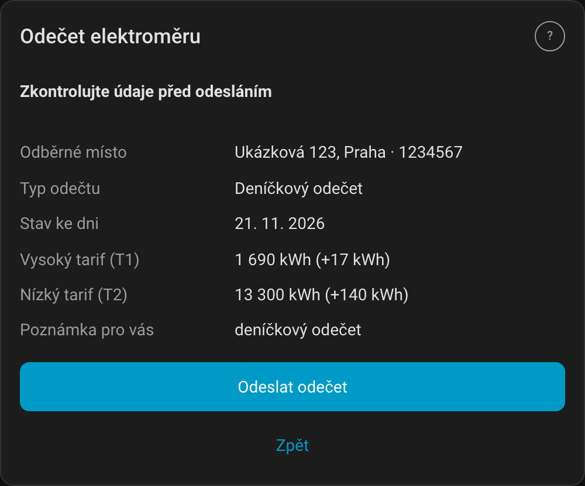
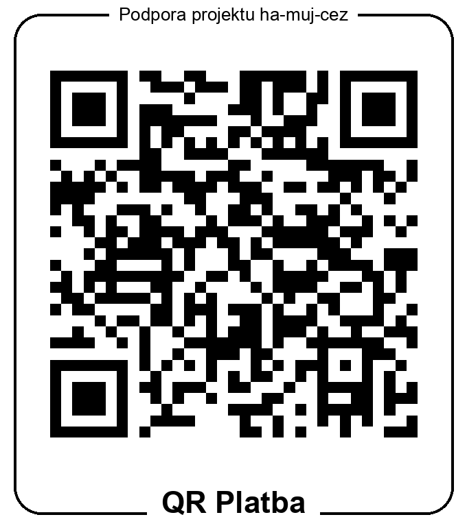

# Můj ČEZ pro Home Assistant: uživatelská příručka

Podrobný popis instalace, nastavení a všech funkcí integrace
[Můj ČEZ](https://github.com/KinDR007/ha-muj-cez). Snímky obrazovky jsou z tmavého režimu
Home Assistantu, osobní údaje (adresa, e-mail, EAN, čísla smlouvy, zákazníka, elektroměru
a dokladů) jsou nahrazené smyšlenými hodnotami.

## Obsah

1. [Instalace a přihlášení](instalace.md): HACS, ruční instalace, přidání integrace, více
   zákaznických účtů, soukromí
2. [Nastavení](nastaveni.md): aktualizace, porovnání s měřením v HA, dashboard, HDO,
   cenový rozpad
3. [Entity](entity.md): senzory odběrného místa, průběhové měření a fotovoltaika, HDO, účet
4. [Dashboard ČEZ](dashboard-cez.md): vyúčtování, zálohy, smlouva, tarif HDO, elektroměr,
   výkup, porovnání s HA, průběh po 15 minutách, spotové ceny, spotřeba, zúčtovací období,
   doklady
5. [Cenový rozpad](cenovy-rozpad.md): platby po položkách za měsíc, kvartál a rok,
   faktury, opravné faktury, ceníky
6. [Odečet elektroměru](odecet.md): zadání samoodečtu s kontrolou hodnot
7. [Akce a automatizace](akce.md): načtení dokladů, aktualizace dashboardu, příklady
8. [Řešení potíží](potize.md): opravy, přihlášení, diagnostika

Snímky se generují nástrojem `tools/docs/shots.mjs` (viz `tools/docs/shots.json`).

## Podpořte vývoj

Integrace je zdarma a vyvíjím ji ve volném čase. Portál ČEZ se průběžně mění a každá jeho
změna může integraci rozbít. Udržet ji funkční, opravovat chyby po změnách portálu, testovat
nové verze Home Assistantu a přidávat funkce jako cenový rozpad nebo odečet elektroměru stojí
desítky hodin práce.

Pokud vám integrace šetří čas nebo peníze, budu rád za příspěvek na další vývoj, ať už
jednorázově, nebo třeba jednou za rok. Částku zadáte v bankovní aplikaci podle sebe.

QR platba (CZK) nebo [PayPal](https://paypal.me/KinDR007)

Pomůže i hvězdička na GitHubu, nahlášení chyby nebo nápad v
[Issues](https://github.com/KinDR007/ha-muj-cez/issues). Děkuji!
