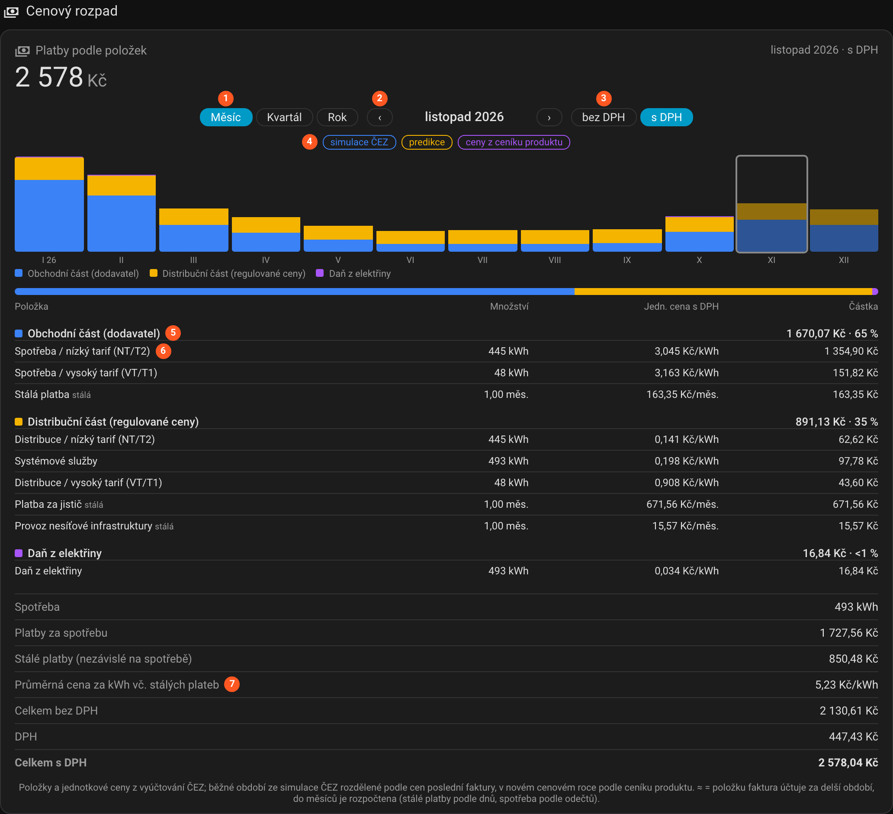
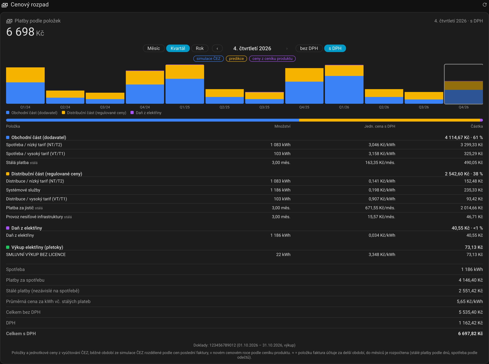
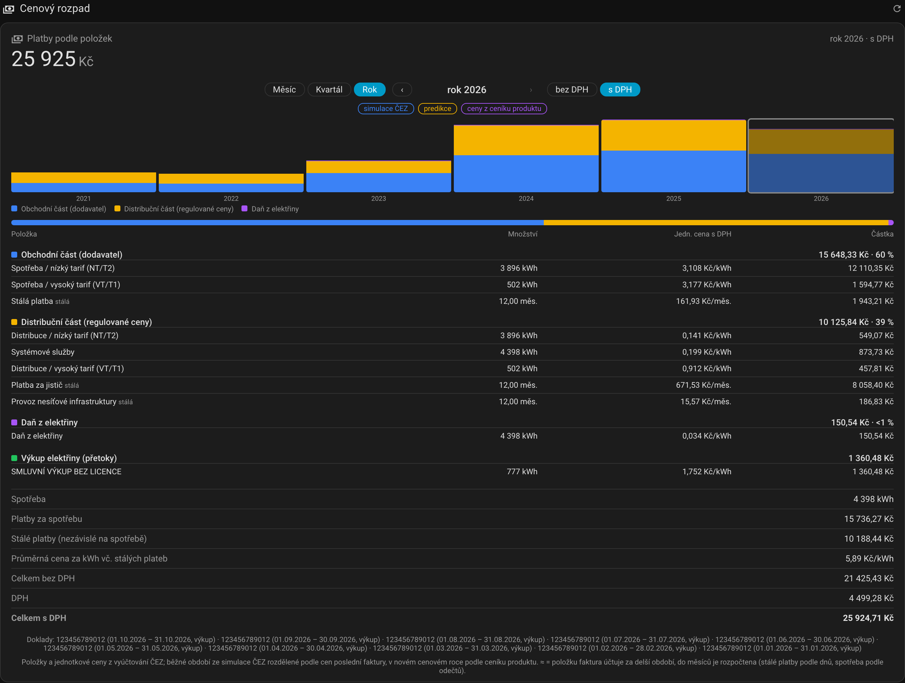
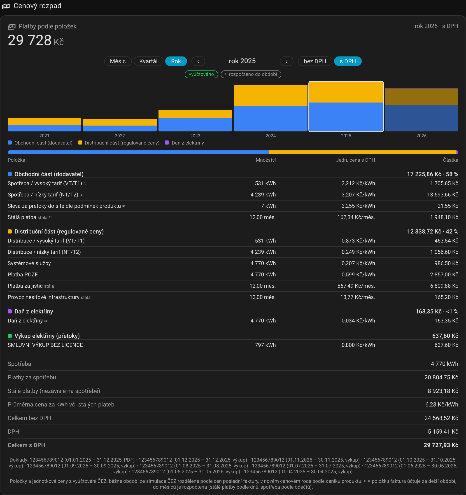

# Cenový rozpad

Vnitřní záložka **Ceny** (ikona bankovky) u odběrného místa ukazuje, kolik stojí
jednotlivé položky vyúčtování elektřiny a plynu po měsících, kvartálech a letech, s DPH i bez.
Zapíná se volbou **Cenový rozpad** v nastavení integrace (u nových instalací je vypnutá).
Ikona **obnovit** v záhlaví po potvrzení hned stáhne nové faktury a ceníky místa; jinak se
hledají podle [periody aktualizace faktur](nastaveni.md#aktualizace-faktur).

## Měsíc

1. **Měsíc / Kvartál / Rok**: velikost období.
2. **Šipky**: posun na předchozí a další období; období lze vybrat i kliknutím na sloupec
   v grafu.
3. **bez DPH / s DPH**: přepnutí všech částek a jednotkových cen.
4. **Štítky zdroje**: odkud čísla pocházejí:
   - *vyúčtováno*: z vyúčtování ČEZ (datový soubor CSV nebo PDF faktury),
   - *simulace ČEZ*: běžné období ze simulace vyúčtování na portálu,
   - *predikce*: období ještě neskončilo, část je odhad,
   - *≈ rozpočteno do období*: faktura účtuje položku za delší období, do měsíců je
     rozpočtená (stálé platby podle dní, spotřeba podle odečtů),
   - *ceny z ceníku produktu*: v novém cenovém roce, než přijde faktura s novými cenami,
   - *ceny nesouhlasí, bez rozpadu*: simulaci nejde rozdělit, zobrazí se jen součty.
5. **Skupiny položek**: obchodní část (dodavatel), distribuční část (regulované ceny),
   daň z elektřiny, u fotovoltaiky výkup. U skupiny je součet a podíl na celku.
6. **Položky**: množství, jednotková cena a částka. *stálá* = platba nezávislá na
   spotřebě (stálá platba, jistič, provoz nesíťové infrastruktury).
7. **Souhrn**: spotřeba, platby za spotřebu a stálé platby, průměrná cena za kWh
   včetně stálých plateb, celkem bez DPH, DPH a celkem s DPH.

Graf nad tabulkou ukazuje posledních 12 období rozdělených podle skupin; vybrané období
je zvýrazněné.

## Kvartál

Stejný rozpis za čtvrtletí, graf ukazuje posledních 12 čtvrtletí. U fotovoltaiky je
v rozpisu skupina **Výkup elektřiny (přetoky)** se zelenou barvou: množství přetoků,
výkupní cena a vyplacená částka. Pod souhrnem je řádek **Doklady** se seznamem faktur
a výkupů, ze kterých období vychází.

## Rok

Běžný rok skládá vyúčtované měsíce, simulaci ČEZ a predikci do konce roku. Graf ukazuje
všechny roky, za které má integrace data (první načtení stáhne 4 roky zpět).

## Vyúčtované období a faktury

Uzavřené období je celé z faktur (štítek **vyúčtováno**):

- položky a jednotkové ceny jsou přesně podle vyúčtování, včetně slev a jednorázových
  položek (například sleva za přetoky podle podmínek produktu),
- **≈** u položky znamená, že ji faktura účtuje za delší období a do měsíců je rozpočtená
  (stálé platby podle dní, spotřeba podle odečtů),
- řádek **Doklady** vypisuje čísla dokladů s obdobím, které pokrývají, a zdroj
  (datový soubor CSV, PDF, výkup),
- **opravné faktury** nahrazují původní doklad za dny, které pokrývají, rozdílová oprava
  se přičte. U nahrazeného dokladu je to v seznamu vyznačené.

Faktury se stahují jen jednou: datový soubor CSV, pokud ho portál má, jinak PDF faktury.
Doklad, který se nepodařilo zpracovat, se zkusí znovu po týdnu.

## Odkud jsou ceny

- **Minulá období**: z vyúčtování.
- **Běžné období**: ze simulace vyúčtování ČEZ rozdělené podle jednotkových cen poslední
  faktury. Měsíc se rozdělí jen tehdy, když ceny vysvětlí částky simulace; jinak se
  zobrazí jen součty (štítek *ceny nesouhlasí, bez rozpadu*).
- **Nový cenový rok**: než přijde faktura s novými cenami, použije se ceník produktu
  z portálu (sloupec vaší distribuční sazby a jističe), případně v kombinaci s poslední
  fakturou (starý produkt s novými distribučními cenami).

## Plyn

Faktury za plyn čte vlastní parser (portál je dává jen v PDF). Obchodní část tvoří
spotřeba (Kč/MWh), stálá platba a daň z plynu (domácnosti jsou osvobozené, uvádí se
s nulou), distribuční část distribuce (Kč/MWh), stálá platba za distribuci a činnost
OTE. Běžné období se rozdělí podle cen poslední faktury, nový cenový rok podle ceníku
plynu (pásmo podle roční spotřeby minulého období; odběr nad 63 MWh s cenou za kapacitu
se nerozkládá a zůstane jako souhrn ze simulace).
