# Dashboard ČEZ

Integrace umí vytvořit vlastní dashboard **ČEZ** nebo přidat záložky do existujícího
(volba **Dashboard** v [nastavení](nastaveni.md)). Záložky:

- **ČEZ** (ikona blesku): přehled popsaný na této stránce,
- **Cenový rozpad** (ikona bankovky): viz [Cenový rozpad](cenovy-rozpad.md), jen se
  zapnutou volbou,
- **Odečet** (ikona počítadla): viz [Odečet elektroměru](odecet.md).

Sekce se přizpůsobí tomu, co účet a Home Assistant mají: s průběhovým měřením (typicky
fotovoltaika) přibudou elektroměr, výkup, přetoky a spotové ceny, s HDO tarif a cena.
Grafy mají popisky po najetí myší nebo dotyku, řádky otevírají detail entity. Snímky níže
jsou z odběrného místa s fotovoltaikou a dvoutarifem.

## Vyúčtování

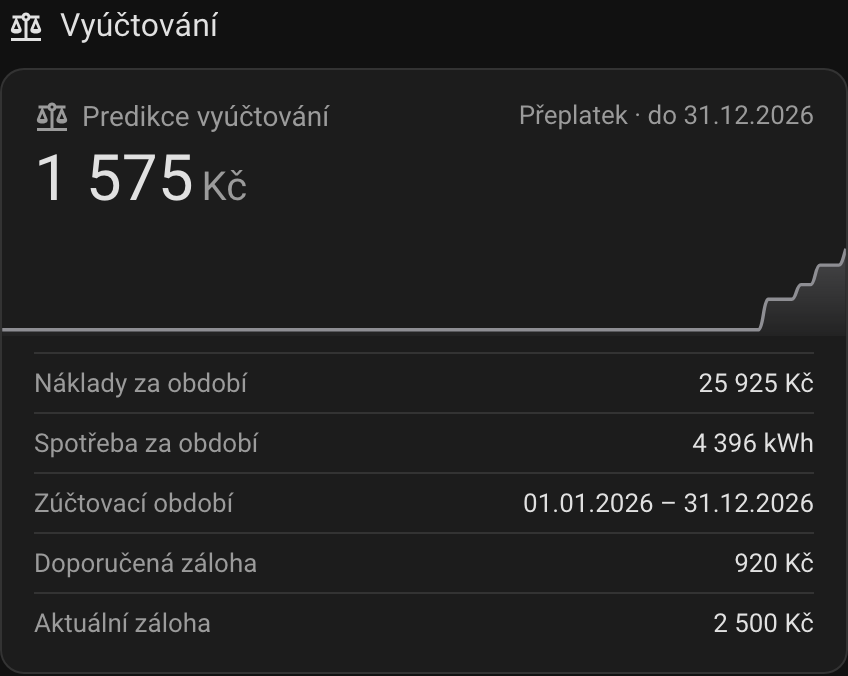

Predikce výsledku vyúčtování za běžné zúčtovací období (přeplatek nebo nedoplatek)
s grafem vývoje, náklady a spotřeba za období podle simulace ČEZ, doporučená a aktuální
záloha.

## Zálohy a platby

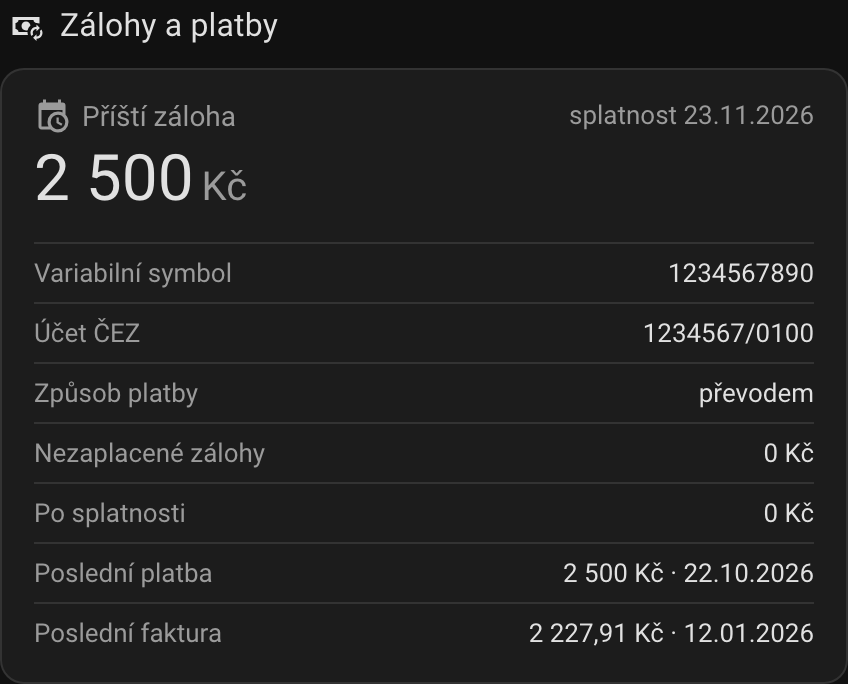

Příští záloha se splatností, variabilní symbol a účet pro platbu, způsob platby,
nezaplacené zálohy a částka po splatnosti, poslední platba a poslední faktura.

## Smlouva a odběrné místo

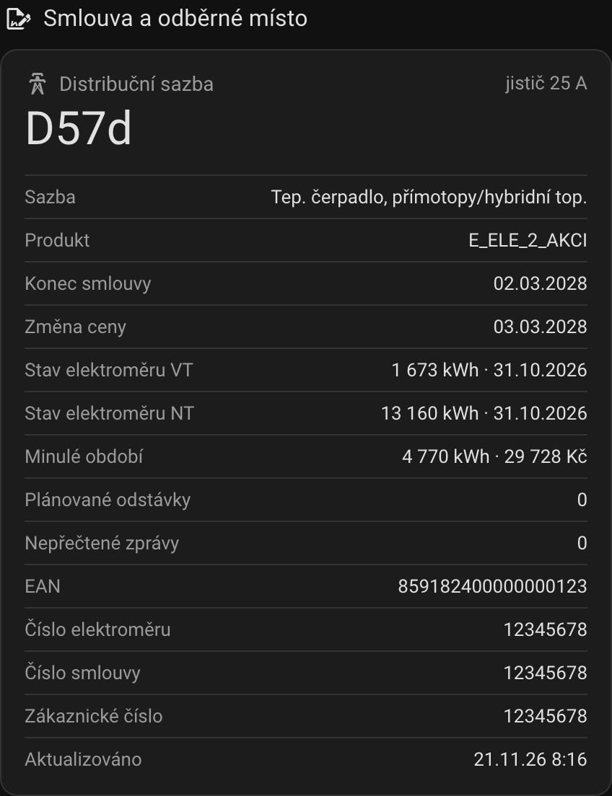

- **Distribuční sazba** a velikost jističe, název sazby a produkt dodavatele.
- **Konec smlouvy** a **změna ceny**: kdy končí smlouva a kdy se mění cena produktu.
- **Stav elektroměru VT / NT**: poslední odečet s datem.
- **Minulé období**: spotřeba a náklady posledního uzavřeného zúčtovacího období.
- **Plánované odstávky** a **nepřečtené zprávy** z portálu.
- **EAN, číslo elektroměru, číslo smlouvy, zákaznické číslo** pro komunikaci s ČEZ.
- **Aktualizováno**: čas posledního načtení dat z portálu.

## Tarif HDO a cena

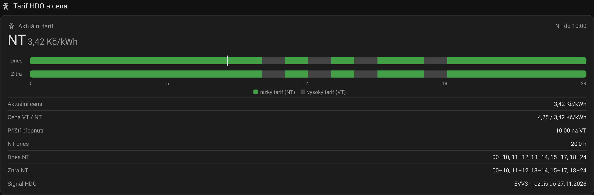

Jen u odběrných míst s HDO a se zapnutou volbou **HDO z ČEZ Distribuce**. Aktuální tarif
(NT/VT) a cena za kWh, časová osa nízkého (zeleně) a vysokého tarifu pro dnešek a zítřek
s vyznačeným aktuálním časem, ceny VT/NT, příští přepnutí, počet hodin NT dnes, časy NT
a signál HDO s datem, do kdy je rozpis načtený.

## Elektroměr

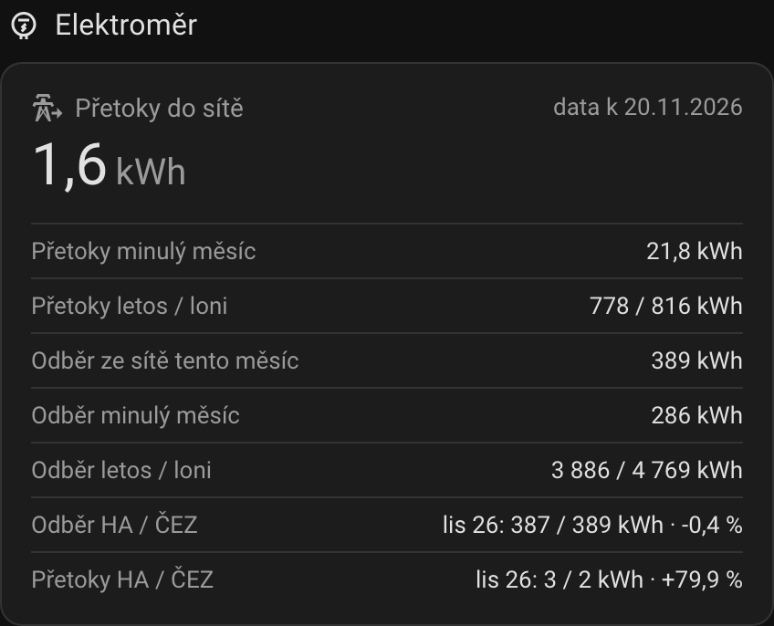

Jen s průběhovým měřením. Přetoky a odběr ze sítě za minulý měsíc, tento měsíc a letos
proti loňsku podle elektroměru ČEZ (data jsou den zpětně) a porovnání s měřením v HA
(referenční senzory z nastavení).

## Výkup přetoků

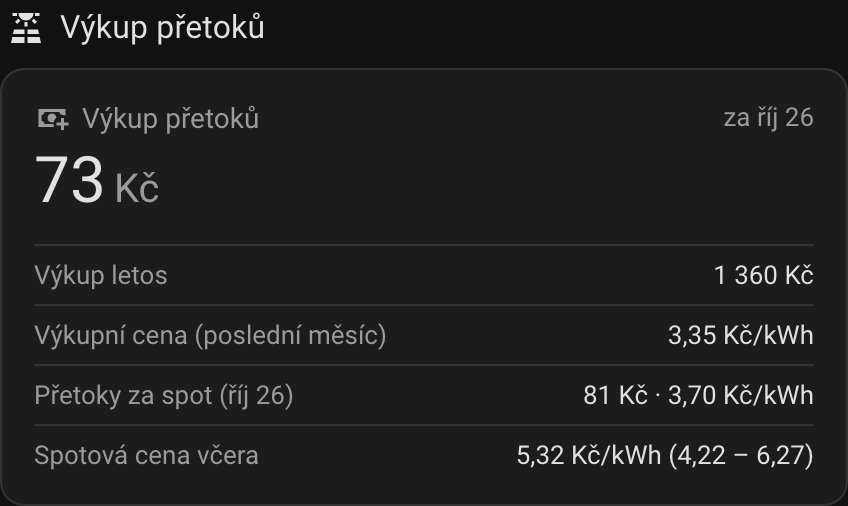

Jen s výrobním odběrným místem. Výkup za poslední měsíc a letos, výkupní cena, přetoky
oceněné spotovou cenou a spotová cena včera.

## HA vs elektroměr ČEZ

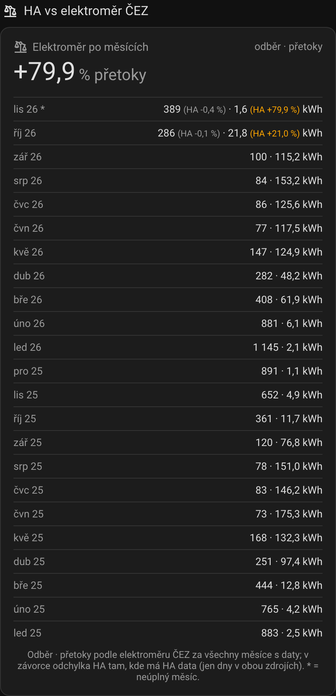

Odběr a přetoky po měsících podle elektroměru ČEZ, v závorce odchylka měření HA tam, kde
jsou data z obou zdrojů. Hvězdička označuje neúplný měsíc.

## Odběr a přetoky po měsících

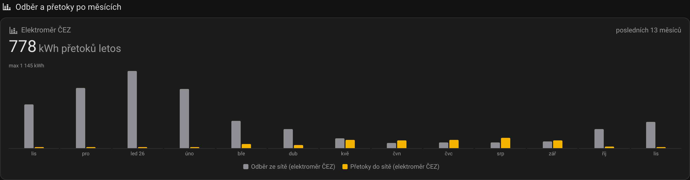

Odběr ze sítě (šedě) a přetoky do sítě (žlutě) za posledních 13 měsíců.

## Výkup po měsících

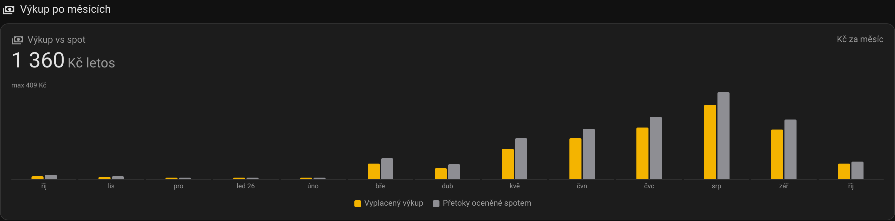

Vyplacený výkup (žlutě) proti hodnotě přetoků oceněných spotovou cenou (šedě).

## Průběh po 15 minutách

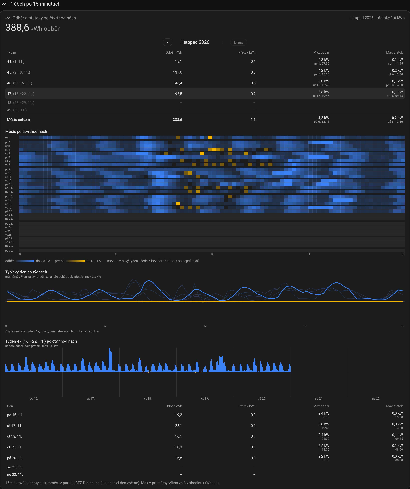

Jen s průběhovým měřením. Čtvrthodinové hodnoty odběru a přetoků po kalendářních měsících
za aktuální měsíc a 12 předchozích; šipkami se přepíná měsíc, tlačítko **Dnes** vrátí
nejnovější data.

- **Tabulka po týdnech**: odběr, přetok a maximální čtvrthodinový výkon s časem.
- **Měsíc po čtvrthodinách**: teplotní mapa dny × čtvrthodiny (modře odběr, žlutě přetok).
- **Typický den po týdnech**: průměrný výkon za čtvrthodinu, zvýrazněný je vybraný týden.
- **Detail týdne**: graf a tabulka po dnech; jiný týden se vybere kliknutím v tabulce.

První načtení historie po instalaci trvá několik minut.

## Spotové ceny

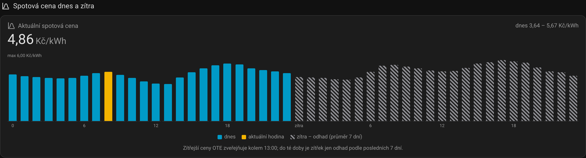

Hodinová spotová cena dnes a zítra s vyznačenou aktuální hodinou. Zítřejší ceny OTE
zveřejňuje kolem 13:00, do té doby je zítřek jen odhad podle posledních 7 dní (šrafovaně).

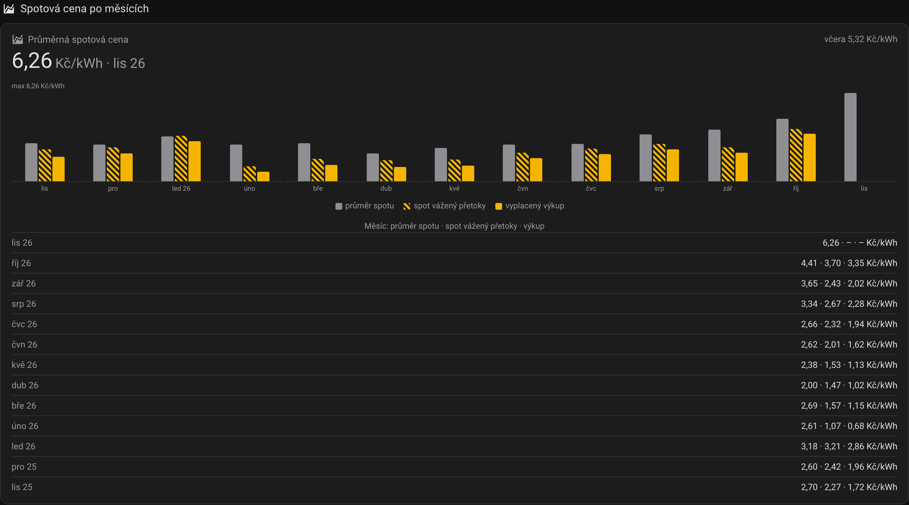

Po měsících průměr spotu, spot vážený přetoky (kolik by přetoky vynesly za spot) a skutečně
vyplacená výkupní cena; pod grafem tabulka s hodnotami.

## Spotřeba po měsících

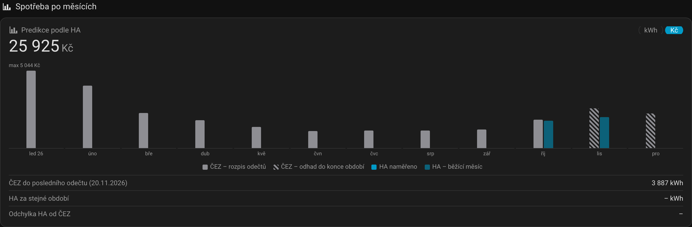

Spotřeba (nebo náklady, přepínač **kWh / Kč**) po měsících běžného zúčtovacího období:
rozpis odečtů ČEZ, odhad do konce období (šrafovaně) a měření HA. Pod grafem srovnání
ČEZ a HA za stejné období.

## Meziroční porovnání

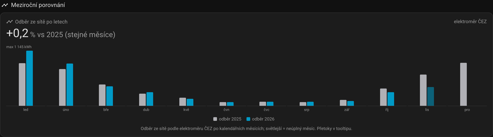

Odběr ze sítě po kalendářních měsících letos proti loňsku podle elektroměru ČEZ; světlejší
sloupec je neúplný měsíc.

## Zúčtovací období

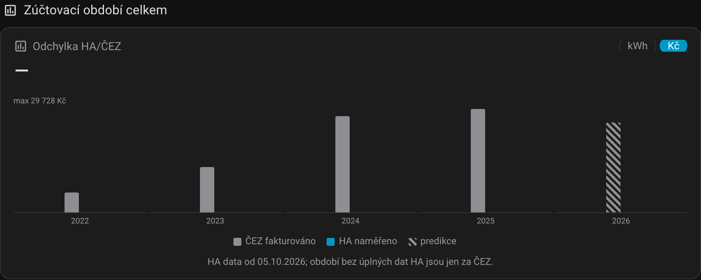

Celkové náklady (nebo spotřeba) zúčtovacích období: fakturováno ČEZ, naměřeno HA a predikce
běžného období.

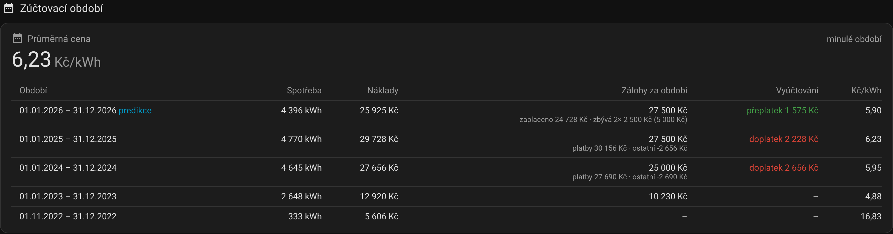

Tabulka období: spotřeba, náklady, zálohy za období (zaplaceno a zbývá), výsledek
vyúčtování (přeplatek zeleně, doplatek červeně) a průměrná cena za kWh včetně stálých
plateb. Běžné období je označené jako predikce.

## Doklady

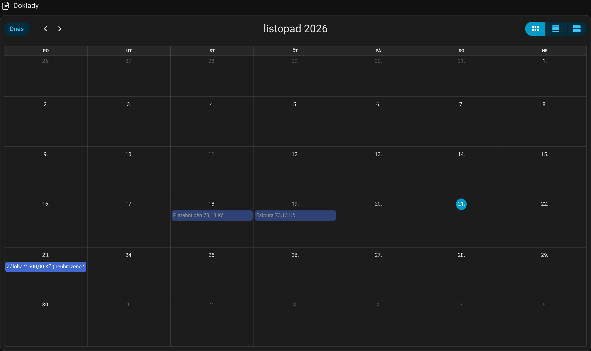

Kalendář všech dokladů účtu (faktury, zálohy, platby, poplatky). Kliknutím na událost se
zobrazí podrobnosti; přepínačem vpravo nahoře se mění zobrazení měsíc / seznam.
