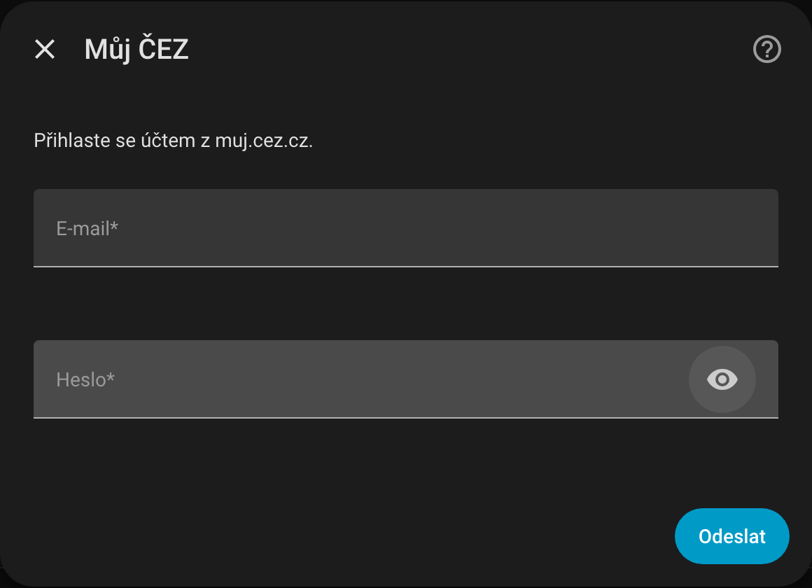
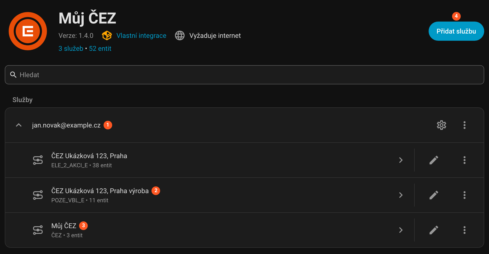

# Instalace a přihlášení

Integrace je neoficiální. Používá stejné rozhraní jako web muj.cez.cz, takže ji může
rozbít změna portálu na straně ČEZ.

**Co je potřeba**

- Home Assistant 2025.8 nebo novější,
- účet na [muj.cez.cz](https://muj.cez.cz) s přihlášením e-mailem a heslem.

## Instalace přes HACS (doporučeno)

1. HACS → menu ⋮ vpravo nahoře → **Vlastní repozitáře**.
2. Repozitář `https://github.com/KinDR007/ha-muj-cez`, typ **Integrace** → **Přidat**.
3. Vyhledejte **Můj ČEZ** → **Stáhnout**.
4. Restartujte Home Assistant.

Nové verze pak HACS nabídne sám v **Nastavení → Aktualizace**. Po aktualizaci obnovte
stránku prohlížeče, aby se načetly nové karty dashboardu.

## Ruční instalace

1. Na GitHubu stáhněte repozitář (**Code → Download ZIP**) a rozbalte ho.
2. Složku `custom_components/muj_cez` zkopírujte do konfigurační složky Home Assistantu
   (doplněk Samba share, File editor, Studio Code Server nebo SSH). Výsledek musí být
   `/config/custom_components/muj_cez/manifest.json`.
3. Restartujte Home Assistant: **Nastavení → Systém → ⏻ → Restartovat Home Assistant**.

Aktualizace se dělá stejně: nahraďte složku `muj_cez` novou verzí a restartujte.

## Přidání integrace

1. **Nastavení → Zařízení a služby → Přidat integraci** a vyhledejte „ČEZ“.
2. Zadejte e-mail a heslo, kterými se přihlašujete na muj.cez.cz, a klikněte na
   **Odeslat**. Integrace se hned přihlásí a načte data, trvá to několik sekund.

   

   Ikona **?** vpravo nahoře otevře tuto příručku.

   Možné chyby:
   - **Neplatný e-mail nebo heslo**: zkontrolujte, že se stejnými údaji přihlásíte na webu.
   - **Nelze se připojit k muj.cez.cz**: portál je nedostupný nebo HA nemá internet,
     zkuste to později.
   - **Účet nemá žádné odběrné místo**: účet nemá aktivní smlouvu.

3. Následuje krok **Nastavení**, popsaný v kapitole [Nastavení](nastaveni.md). Všechny
   volby jdou později změnit.

## Po přidání

1. **Účet** (podle e-mailu). Ozubené kolo vpravo otevře [nastavení](nastaveni.md),
   menu ⋮ nabízí znovu načíst, stáhnout diagnostiku nebo odebrat.
2. **ČEZ &lt;adresa odběrného místa&gt;**: zařízení odběrného místa se senzory vyúčtování,
   záloh, spotřeby a smlouvy. U fotovoltaiky přibude druhé zařízení **… výroba** pro
   výkup přetoků.
3. **Můj ČEZ**: zařízení účtu s kalendářem **Doklady**, počtem nepřečtených zpráv
   a přepínačem jednotky grafů (kWh / Kč).
4. **Přidat službu**: další účet (viz níže).

Popis všech entit je v kapitole [Entity](entity.md).

## Více zákaznických účtů

Pokud máte pod jedním ČEZ ID přístup k více zákaznickým účtům (například sdílený účet jiné
osoby), integrace se při přidání zeptá, který účet načíst. Další účet přidáte tlačítkem
**Přidat službu** se stejným přihlášením. Každý účet má vlastní nastavení a vlastní záložky
dashboardu.

## Soukromí

Přihlašovací údaje ukládá Home Assistant lokálně v konfiguraci integrace. Integrace
komunikuje s portálem ČEZ a data načítá jednou za zvolenou periodu (a při startu).
Jen u účtů s průběhovým měřením stahuje navíc veřejné spotové ceny z OTE a kurz EUR
z ČNB; posílá se jen datum, žádné osobní údaje. Se zapnutým HDO se stejné přihlašovací
údaje používají i pro portál ČEZ Distribuce.
