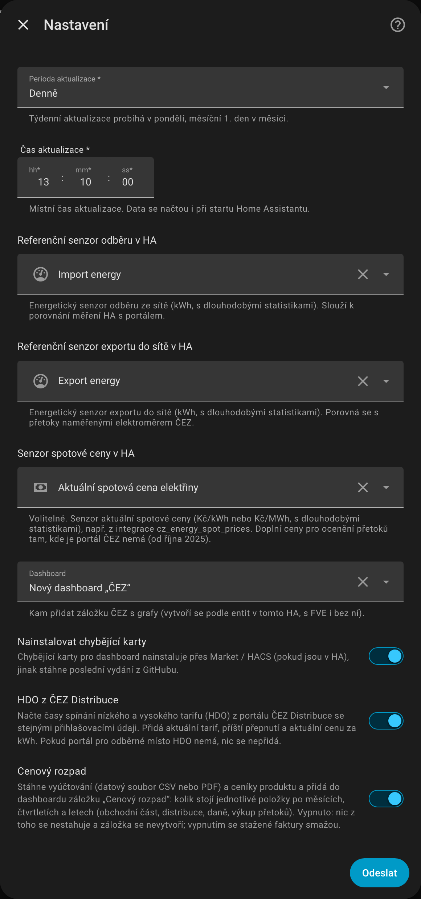

# Nastavení

Nastavení se zobrazí při přidání integrace (krok **Nastavení** po přihlášení) a později
přes ozubené kolo u účtu v **Nastavení → Zařízení a služby → Můj ČEZ**. Uložením se
integrace znovu načte.

## Aktualizace dat

- **Perioda aktualizace**: denně, týdně (v pondělí) nebo měsíčně (1. den v měsíci).
  Data na portálu se mění zřídka, týdenní perioda většinou stačí.
- **Čas aktualizace**: místní čas načtení dat. Data se načtou i při každém startu
  Home Assistantu.

Když aktualizace selže, zkouší se znovu 6× po 30 minutách a entity mezitím drží poslední
hodnoty.

## Porovnání s měřením v Home Assistantu

- **Referenční senzor odběru v HA** (nepovinné): energetický senzor odběru ze sítě v kWh
  s dlouhodobými statistikami, typicky ten, který používá panel Energie. Integrace podle
  něj porovnává měření HA s tím, co eviduje a fakturuje ČEZ (senzor **Odchylka od ČEZ**
  a sekce dashboardu se srovnáním).
- **Referenční senzor exportu do sítě v HA** (nepovinné): senzor přetoků do sítě. Porovná
  se s přetoky naměřenými elektroměrem ČEZ (jen u elektroměru s průběhovým měřením).
- **Senzor spotové ceny v HA** (nepovinné): například `sensor.current_spot_electricity_price`
  z integrace cz_energy_spot_prices. Portál ČEZ má spotové ceny jen do září 2025, senzor
  doplní ceny pro ocenění přetoků za dobu, kterou pokrývají jeho statistiky.

Senzory odběru a exportu se při instalaci předvyplní podle panelu Energie a senzor spotové
ceny podle integrace cz_energy_spot_prices.

## Dashboard

- **Dashboard**: kam přidat záložky ČEZ: nový dashboard „ČEZ“, některý existující, nebo
  nevytvářet. Záložky se vygenerují podle entit v tomto HA (s fotovoltaikou i bez ní)
  a při každém načtení integrace se aktualizují; ostatní záložky dashboardu zůstanou beze
  změny. Popis v kapitolách [Dashboard ČEZ](dashboard-cez.md),
  [Cenový rozpad](cenovy-rozpad.md) a [Odečet elektroměru](odecet.md).
- **Nainstalovat chybějící karty** (výchozí zapnuto): dashboard potřebuje karty
  **button-card**, **stack-in-card** a **mini-graph-card**. Chybějící integrace nainstaluje
  přes Market (HA od 2026.11) nebo HACS, které je pak samy aktualizují; bez nich stáhne
  poslední vydání z GitHubu. Když je volba vypnutá nebo instalace selže, objeví se
  v **Nastavení → Opravy** oznámení s tlačítkem **Opravit**. Kartu **Odečet** dodává
  integrace sama, nic dalšího nepotřebuje.

## Další data

- **HDO z ČEZ Distribuce** (výchozí zapnuto): načte časy spínání nízkého a vysokého tarifu
  z portálu ČEZ Distribuce se stejnými přihlašovacími údaji. Přidá aktuální tarif, příští
  přepnutí a aktuální cenu za kWh. Pokud portál pro odběrné místo HDO nemá, nic se nepřidá.
- **Cenový rozpad** (u nových instalací vypnuto): stáhne vyúčtování (datový soubor CSV
  nebo PDF) a ceníky produktu a přidá záložku **Cenový rozpad**. Vypnutý: nic z toho se
  nestahuje, záložka se nevytvoří a vypnutím se stažené faktury smažou. Knihovnu `pypdf`
  pro PDF faktury Home Assistant doinstaluje až při zapnutí.

## Změna hesla

Po změně hesla na portálu zobrazí Home Assistant v **Nastavení** výzvu k novému
přihlášení; stačí zadat nové heslo.
