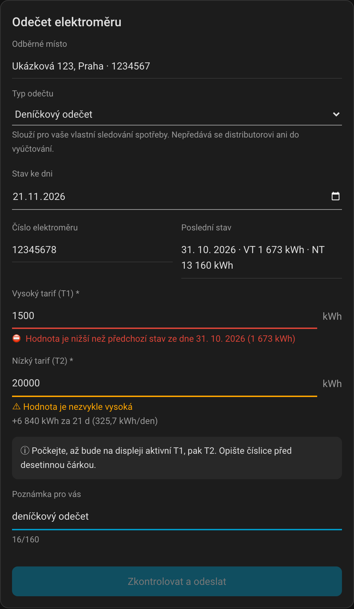
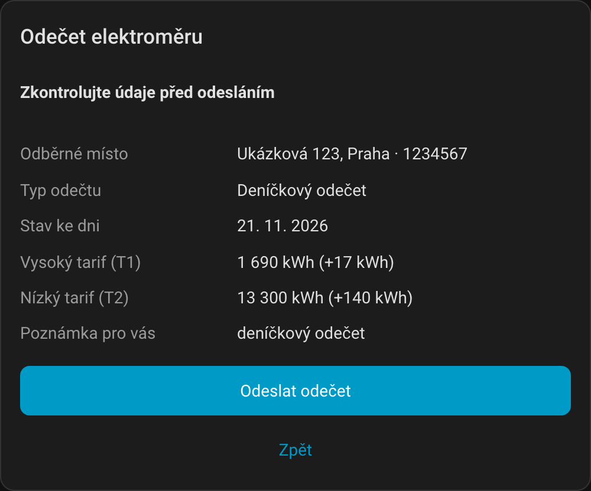

# Odečet elektroměru

Záložka **Odečet** (ikona počítadla vedle záložky ČEZ) slouží k zadání samoodečtu
elektroměru přímo z Home Assistantu, stejně jako na portálu Můj ČEZ. Hodnoty se
kontrolují už při psaní podle stejných pravidel jako na portálu, takže se včas ukáže
překlep nebo přehozená čísla.

Kartu dodává integrace sama, není potřeba nic doinstalovat. Na vlastní dashboard ji
lze přidat jako kartu typu `custom:muj-cez-reading-card` (volitelně `entry_id` pro
konkrétní účet, `ean` pro výchozí odběrné místo a `title`). Ikona **?** v záhlaví karty
otevře tuto stránku.

## Formulář

1. **Odběrné místo**: odběrná místa elektřiny účtu. Při více místech se vybírá ze
   seznamu, u jednoho je jen zobrazené.
2. **Typ odečtu**: nabízí jen typy, které portál u místa právě povoluje. Pod výběrem je
   popis, co se s odečtem stane:
   - *Kontrolní odečet pro distributora*: předá se distributorovi a zohlední ve
     vyúčtování (počet za rok je omezený, karta ukáže, kolik zbývá).
   - *Deníčkový odečet*: jen pro vaše sledování, distributorovi se nepředává.
   - *Odečet pro mimořádné vyúčtování*: předá se distributorovi a vystaví se podle něj
     mimořádné vyúčtování.
   - *Odečet pro informace o vyúčtování*: přehled o spotřebě, předává se distributorovi.
3. **Stav ke dni**: výchozí je dnešek. Portál přijme jen datum v určitém rozsahu
   (většinou 30 dní zpět, u mimořádného vyúčtování méně) a ne dřív než poslední odečet.
4. **Číslo elektroměru**: doplní se samo podle odečtů z portálu.
5. **Poslední stav**: poslední známý odečet z portálu (distributor i vaše samoodečty),
   načtený čerstvě při otevření záložky.
6. **Vysoký tarif (T1)**: stav v celých kWh, číslice před desetinnou čárkou.
7. **Nízký tarif (T2)**: jen u dvoutarifové sazby.
8. **Poznámka pro vás**: volitelný text do 160 znaků, uloží se k odečtu na portálu.
9. **Zkontrolovat a odeslat**: aktivní, jakmile jsou hodnoty v pořádku.

## Kontrola hodnot

- **Červeně (chyba)**: hodnota nižší než předchozí stav, chybějící nebo neceločíselná
  hodnota, datum mimo povolený rozsah, druhý odečet stejného typu v jednom dni nebo
  vyčerpané kontrolní odečty. Odeslat nejde.
- **Oranžově (varování)**: hodnota je nezvykle vysoká, tj. spotřeba od posledního stavu
  přesahuje 1,5× obvyklou denní spotřebu za poslední zúčtovací období. Odeslat lze,
  jde jen o upozornění na možný překlep.
- Pod každou hodnotou je spotřeba od posledního stavu a průměr na den.

## Souhrn a odeslání

Po kliknutí na **Zkontrolovat a odeslat** se zobrazí souhrn se spotřebou od posledního
stavu. Teprve **Odeslat odečet** pošle odečet na portál, **Zpět** vrátí formulář.
U typů, které se předávají distributorovi, je v souhrnu upozornění.

Po odeslání karta potvrdí výsledek a načte nový poslední stav. Pokud portál hodnoty
označí jako neobvyklé nebo je distributor zamítne, karta to oznámí; zamítnutý odečet
je potřeba zadat znovu na portálu s fotografií displeje.

Odeslat odečet mohou jen administrátoři Home Assistantu.
